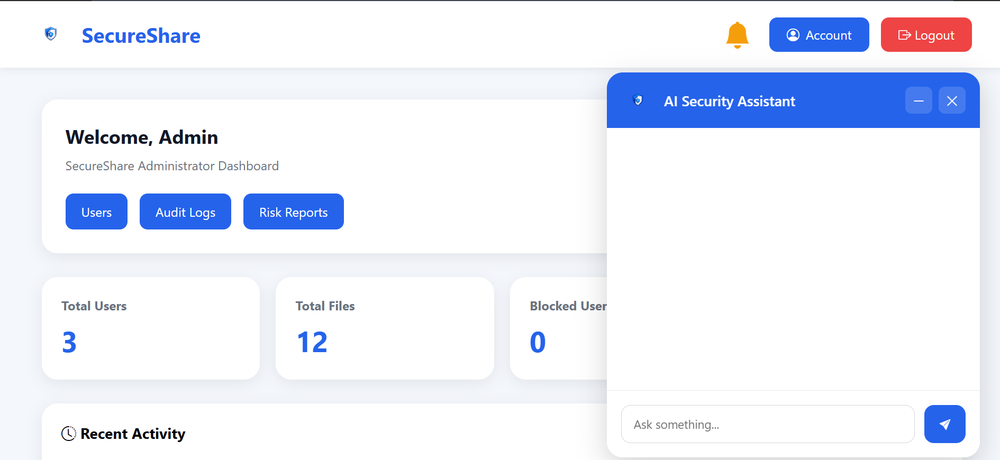

# Responsible AI-Based Risk Assessment System – AI Assistant

## Overview

The Responsible AI-Based Risk Assessment System is an AI-powered application designed to analyse user authentication and activity information, explain risk assessment results and provide recommendations to support informed decision-making.

The system combines rule-based risk assessment, Large Language Models (LLMs), Retrieval-Augmented Generation (RAG), external API data collection and data fusion to provide understandable explanations based on available information.

The AI Assistant uses the Qwen2.5-1.5B-Instruct model to generate responses and retrieve relevant information from a policy-based knowledge base and an enriched dataset.

The chatbot interface is integrated into the administrator dashboard of a separate application, SecureShare. The risk assessment and AI processing functionality belong to this project.

## Objectives

- Analyse user authentication and activity information.
- Identify and explain different user risk levels.
- Generate understandable explanations of risk assessment results.
- Use RAG to retrieve relevant information from security policy documents.
- Collect additional IP-related information using external APIs.
- Combine original authentication data with API-enriched information.
- Retrieve relevant records from the fused dataset.
- Generate context-based assessments and actionable recommendations.

## Key Features

### User Risk Assessment
- Analyse user authentication information.
- Identify high, medium and low risk users.
- Examine failed login attempts and session duration.
- Consider account status, user roles and suspicious activity.
- Provide explanations of assessed risk levels.

### AI Assistant
- Natural language question answering.
- LLM-generated explanations.
- Policy-based knowledge retrieval using RAG.
- Security-related recommendations.
- Responses based on retrieved user and dataset information.

### Additional Analysis
- Blocked user information.
- Failed login summaries.
- Overall risk summaries.
- File security analysis.
- IP security analysis.

### API Data Integration
- AbuseIPDB API integration.
- IPinfo API integration.
- IP address-based data matching.
- Authentication and external API data fusion.
- Retrieval of matching records from the final fused dataset.

## Technologies Used

| Category | Technologies |
|---|---|
| Programming Language | Python |
| Large Language Model | Qwen2.5-1.5B-Instruct |
| AI Framework | Hugging Face Transformers |
| AI Architecture | LLM and RAG |
| Backend | Flask |
| Database | MySQL |
| Data Processing | Pandas, NumPy |
| Dataset Format | CSV, Excel |
| External APIs | AbuseIPDB, IPinfo, VirusTotal |
| Threat Knowledge Source | MITRE ATT&CK |
| Development Tools | Visual Studio Code, XAMPP |

## Original Dataset

The original dataset contains user authentication and activity information used by the risk assessment system.

The dataset includes attributes such as:

- User ID
- IP Address
- Device Type
- Operating System
- Browser
- Login Success Status
- Account Status
- Failed Attempts
- Session Duration
- User Role
- Privilege Level
- Suspicious Activity
- Blocked Status

The dataset was prepared by selecting relevant attributes, cleaning the data and removing duplicate records. The prepared dataset contains approximately 5,000 records.

## API Data Collection

External IP intelligence was collected using two APIs to enrich the original authentication dataset.

### AbuseIPDB

AbuseIPDB provides information about IP addresses reported for abusive activities.

The collected attributes include:

- Abuse Confidence Score
- Total Reports
- Country Code
- Usage Type
- ISP
- Domain
- Whitelist Status
- Last Reported Date

### IPinfo

IPinfo provides additional information about IP addresses, including:

- Hostname
- City
- Region
- Country
- Location Coordinates
- Organisation
- Postal Code
- Timezone

These API responses provide additional context that is not available in the original authentication dataset.

## Data Fusion Methodology

Data fusion was performed to combine the original authentication dataset with external IP intelligence.

The IP address was used as the common matching attribute.

The process involved:

1. Loading the prepared authentication dataset.
2. Extracting IP addresses from the original records.
3. Collecting corresponding information using AbuseIPDB and IPinfo.
4. Matching API responses with the original records using IP addresses.
5. Combining authentication attributes with the additional API information.
6. Saving the enriched records in the final fused Excel dataset.

The final dataset retains the original authentication information and includes additional API-related attributes.

## Fusion Validation and Data Quality

The final fused dataset was checked to verify the matching and availability of API information.

The validation process included:

- Checking IP address matching.
- Verifying API-enriched columns.
- Reviewing the API match status.
- Examining matched records.
- Checking missing and unavailable values.
- Reviewing data consistency.

Missing API information is distinguished from zero-valued results. An unavailable API value does not necessarily indicate that an IP address has no reported activity.

## LLM and RAG Integration

The system uses the Qwen2.5-1.5B-Instruct model through Hugging Face Transformers to generate explanations and recommendations.

### Policy-Based Retrieval

The RAG component retrieves relevant information from the policy knowledge base based on user risk conditions.

The knowledge base contains:

- `blocked_user_policy.txt`
- `failed_login_policy.txt`
- `high_risk_policy.txt`
- `medium_risk_policy.txt`
- `low_risk_policy.txt`
- `long_session_policy.txt`
- `recommendation_policy.txt`

The retrieved policy information supports the generation of context-based explanations and recommendations.

### Fused Dataset Retrieval

The AI Assistant also supports structured retrieval from the final fused Excel dataset.

The workflow is:

1. The administrator enters an IP-related question.
2. The chatbot identifies the fused dataset query.
3. The IP address is extracted from the question.
4. Matching records are retrieved from the fused Excel dataset.
5. The retrieved authentication and API information is passed to the LLM.
6. The LLM generates an explanation using the retrieved information.
7. The response is displayed through the chatbot interface.

The generated fused dataset report contains:

1. Authentication Analysis
2. API Intelligence
3. Combined Security Assessment
4. Recommendation

The fused dataset retrieval uses IP address matching rather than semantic vector search.

## Working of the AI Assistant

The application follows two main information retrieval workflows.

### User Risk Analysis

1. An administrator submits a user-related question.
2. The chatbot identifies the question intent.
3. Relevant user information is retrieved from the database.
4. The risk assessment information and relevant policies are considered.
5. The LLM generates an explanation.
6. The response is displayed in the chatbot.

### Fused Dataset IP Analysis

1. An administrator submits an IP-related question.
2. The chatbot identifies the fused dataset intent.
3. The IP address is extracted.
4. Matching records are retrieved from the fused Excel dataset.
5. The retrieved information is passed to the LLM.
6. The LLM generates a combined security assessment and recommendation.
7. The response is displayed in the chatbot interface.

## Example Queries

The AI Assistant supports questions such as:

- Explain the risk associated with a user.
- Show high risk users.
- Show medium risk users.
- Show low risk users.
- Show blocked users.
- Show failed login attempts.
- Provide an overall risk summary.
- Analyse file security results.
- Check IP security information.
- Check the fused dataset security information for IP `218.149.142.253`.

## Testing and Results

The application was tested through terminal-based execution and through the chatbot interface.

Testing covered:

- Chatbot intent detection.
- User risk-related queries.
- Retrieval of policy information.
- API data collection and enrichment.
- IP-based fused dataset retrieval.
- LLM-generated security explanations.
- Display of responses through the chatbot interface.

For the fused dataset integration, the IP address `218.149.142.253` was tested.

The system successfully retrieved one matching record from the fused Excel dataset. The retrieved record included authentication information and available AbuseIPDB and IPinfo attributes. The AI Assistant generated a report containing authentication analysis, API intelligence, a combined security assessment and recommendations.

## Application Interface

The AI Assistant is accessible through the administrator dashboard of the separate SecureShare application.

The dashboard provides the chatbot interface, while the Responsible AI-Based Risk Assessment System handles the AI processing, risk analysis, retrieval and response generation.

### 1. AI Assistant Interface


### 2. IP Risk Assessment Using Fused Dataset
.png)
.png)
.png)
.png)
### 3. User Risk Assessment
.png)
.png)

## Installation and Setup

### Prerequisites

- Python 3.x
- MySQL
- XAMPP
- Visual Studio Code
- Required Python dependencies

### 1. Clone the Repository

```bash
git clone <repository-url>
```

### 2. Open the Project

Open the project folder in Visual Studio Code.

### 3. Create a Virtual Environment

```bash
python -m venv venv
```

Activate it on Windows:

```powershell
venv\Scripts\activate
```

### 4. Install Dependencies

```bash
pip install -r requirements.txt
```

### 5. Configure the Database and API Credentials

Configure the required MySQL connection details and external API credentials using your local configuration.

Do not upload passwords, API keys or private credentials to GitHub.

### 6. Start the AI Assistant Backend

Run the Flask application:

```bash
python src/app.py
```

The local Flask server runs at:

```text
http://127.0.0.1:5000
```

### 7. Access the Chatbot Interface

Start the required Apache and MySQL services through XAMPP and open the separate SecureShare administrator dashboard.

The Flask backend must be running for the chatbot interface to communicate with the AI Assistant.

## Future Scope

- Improved LLM response evaluation.
- Enhanced retrieval techniques.
- Semantic search using embedding models.
- Integration of vector databases.
- Additional external data sources.
- Improved real-time data processing.
- Further improvements to the explanation and recommendation process.

## References

1. [Hugging Face](https://huggingface.co/)
2. [Qwen2.5-1.5B-Instruct](https://huggingface.co/Qwen/Qwen2.5-1.5B-Instruct)
3. [Hugging Face Transformers Documentation](https://huggingface.co/docs/transformers/)
4. [AbuseIPDB API Documentation](https://docs.abuseipdb.com/)
5. [IPinfo Documentation](https://ipinfo.io/developers)
6. [VirusTotal](https://www.virustotal.com/)
7. [MITRE ATT&CK](https://attack.mitre.org/)
8. [Flask Documentation](https://flask.palletsprojects.com/)
9. [Pandas Documentation](https://pandas.pydata.org/docs/)