# 📚 BookMuse 2.0 — AI-Powered Book Companion

**Your Multimodal AI Companion — Talk about ANY book, visualize scenes, listen to responses, and analyze cover art!**

BookMuse 2.0 is an AI-powered, multimodal book companion built with Python and Streamlit. It combines conversational AI, Retrieval-Augmented Generation (RAG), external book APIs, image processing, voice interaction, personalized recommendations, and data analytics to create an interactive reading experience.

[](https://www.python.org/)
[](https://streamlit.io/)
[](https://groq.com/)
[](https://github.com/MCA-Class-2025/MCA-Student-Applications-2025-2026)

---

## 📑 Table of Contents

- [Project Overview](#-project-overview)
- [Application Screenshots](#-application-screenshots)
- [Key Features](#-key-features)
- [AI and API Architecture](#-ai-and-api-architecture)
- [Data Science and Analytics](#-data-science-and-analytics)
- [Machine Learning Algorithms](#-machine-learning-algorithms)
- [Technology Stack](#-technology-stack)
- [Project Structure](#-project-structure)
- [Installation and Setup](#-installation-and-setup)
- [Environment Variables](#-environment-variables)
- [Running the Application](#-running-the-application)
- [Future Enhancements](#-future-enhancements)
- [Author](#-author)

---

## 🌟 Project Overview

BookMuse 2.0 transforms the way readers interact with books. Instead of simply reading book descriptions, users can have AI-powered conversations about stories, explore characters and themes, generate visual scenes, analyze book covers, discover recommendations, and compare books with their movie adaptations.

The application also integrates external book information sources and maintains datasets for data exploration, visualization, and machine learning experiments.

### 🎯 Project Objectives

- Build an interactive AI companion for discussing books.
- Enable book discovery using external APIs and dynamically retrieved data.
- Apply RAG to retrieve relevant information for AI-powered discussions.
- Integrate multimodal capabilities such as voice interaction, OCR, and AI-generated visual scenes.
- Provide personalized book recommendations and genre-based learning.
- Perform data fusion, exploratory data analysis, and machine learning experiments on book datasets.

---

## 📸 Application Screenshots

### 1. AI Companion Chat

Interact with an AI book companion and ask questions about characters, plot twists, themes, symbolism, story meanings, and narrative structure. Supports voice input and text-to-speech responses.

![AI Companion Chat]screenshots/01-homepage.png)

### 2. AI Scene Visualizer

Turn written book-scene descriptions into cinematic visual representations using AI-powered text-to-image generation.

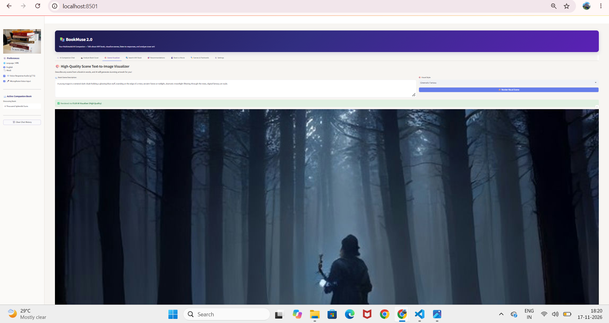.

### 3. Personalized Book Recommendations

Discover books based on favourite titles, preferred genres, and reading moods.

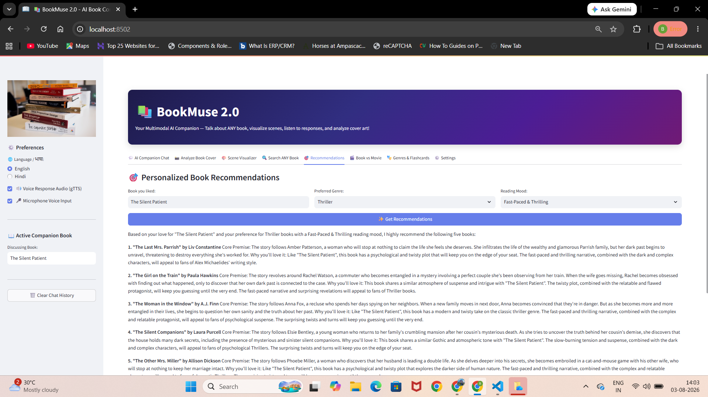

### 4. Book vs Movie Comparison

Explore book-to-film adaptations through comparisons of plot, characters, narrative changes, and adaptation choices.

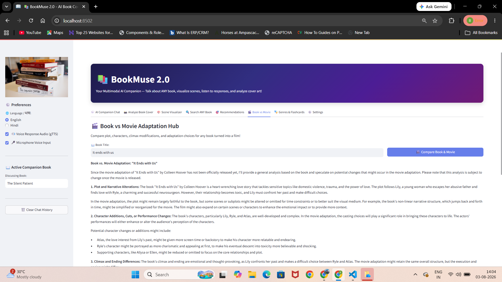

### 5. Genres and Flashcards

Explore books by genre and use interactive trivia flashcards to learn about books, authors, stories, and literary topics.

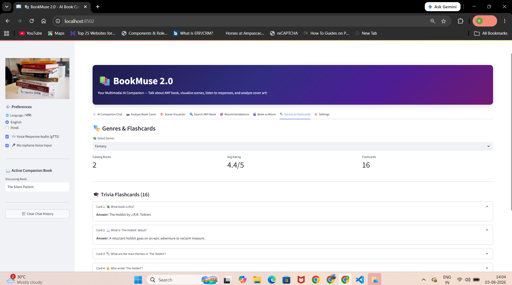

### 6. Dynamic Book Search

Search for books and retrieve available metadata, author information, summaries, and other details from external sources. Retrieved records can also be added to the dynamic dataset.

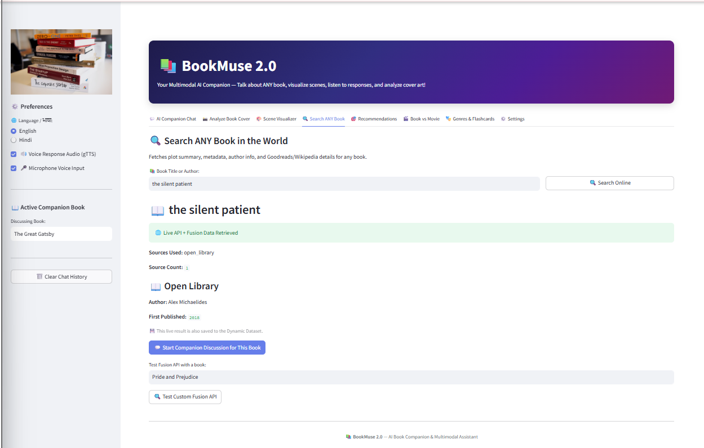

### 7. API Architecture and System Settings

View the integrated API architecture, supported languages, audio and voice settings, and system metadata.

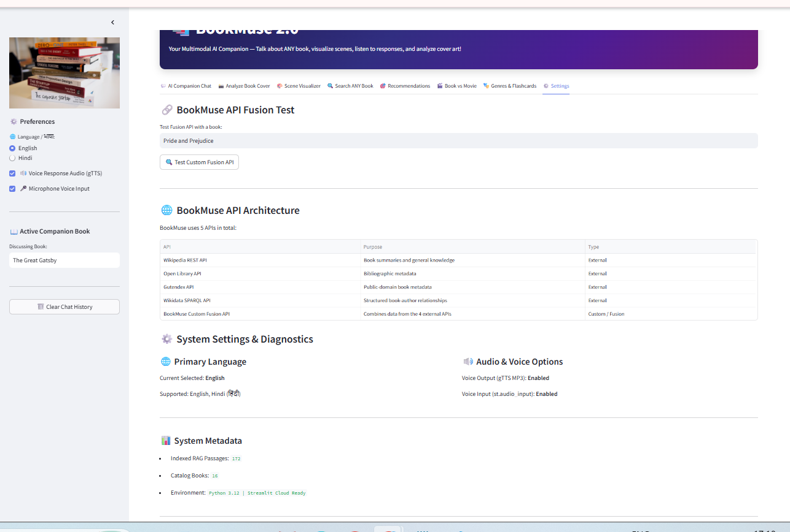

### 8. AI-Powered Book Cover Analysis

Upload a book cover to identify the book and author, examine visual design and cover aesthetics, generate a story synopsis, explore key characters and themes, and receive discussion prompts.

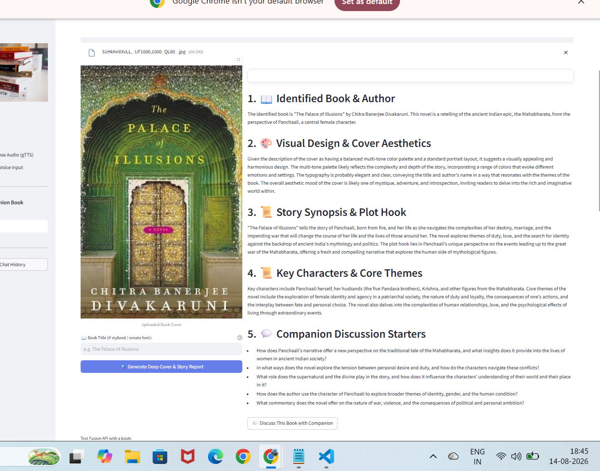

---

## ✨ Key Features

### 🗣️ Voice Interface
- Voice input for asking questions.
- Text-to-speech responses.
- English and Hindi language options.
- Audio response and microphone preferences.

### 📚 AI Book Companion
- Discuss a wide range of books.
- Explore characters, plot, themes, symbolism, and endings.
- Generate explanations and discussion prompts.
- Use RAG-based retrieval for relevant book information.

### 🔎 Dynamic Book Search and API Integration
- Search for books using external information sources.
- Retrieve available book metadata and author information.
- Combine information from multiple sources through a custom fusion API.
- Save dynamically retrieved records into datasets.

### 🖼️ AI Book Cover Analysis
- Upload book cover images.
- Extract and process image text using OCR.
- Identify book titles and authors.
- Generate cover aesthetics analysis, story summaries, character insights, and themes.

### 🎨 AI Scene Visualization
- Convert textual scene descriptions into visual representations.
- Generate cinematic interpretations of book scenes.

### 🎯 Personalized Recommendations
- Recommend books based on favourite titles.
- Filter suggestions by preferred genre and reading mood.
- Discover books with similar themes and reading experiences.

### 🎬 Book vs Movie
- Compare literary works with their film adaptations.
- Explore narrative and character differences.
- Understand adaptation choices and storytelling changes.

### 🎭 Genres and Flashcards
- Explore multiple book genres.
- View genre-based book information.
- Learn through interactive trivia flashcards.

### 📊 Data Science and Analytics
- Combine book records from different data sources.
- Perform dataset preparation and cleaning.
- Explore book ratings, categories, publication years, and other attributes.
- Generate visualizations and conduct machine learning experiments.

---

## 🧠 AI and API Architecture

BookMuse integrates external information sources with its own processing components.

### External and Custom APIs

| API / Source | Purpose |
|---|---|
| Wikipedia REST API | Book summaries and general knowledge |
| Open Library API | Bibliographic metadata |
| Google Books API | Book and publication information |
| Wikidata SPARQL API | Structured book-author relationships |
| BookMuse Custom Fusion API | Combines information from external sources |

### AI Components

| Component | Purpose |
|---|---|
| Groq LLaMA 3.3-70B | AI-powered conversational responses |
| RAG | Retrieval of relevant information for discussions |
| FAISS | Vector-based similarity search |
| Embeddings | Semantic representation of text |
| OCR | Text extraction from uploaded book covers |
| Text-to-Speech | Converts AI responses into audio |
| Speech Input | Enables voice-based interaction |

---

## 📊 Data Science and Analytics

BookMuse also includes a data science workflow focused on book datasets.

### Data Preparation and Fusion

- Collect and combine book information from different sources.
- Prepare static and dynamically retrieved datasets.
- Perform data cleaning and preprocessing.
- Generate fused datasets for further analysis.

### Exploratory Data Analysis (EDA)

The project includes visual analysis of:

- Missing values.
- Book category distribution.
- Average rating distribution.
- Page-count distribution.
- Publication-year distribution.
- Ratings-count distribution.
- Correlation between numerical attributes.
- API source distribution.
- Before-and-after dataset comparisons.

### EDA Visualizations

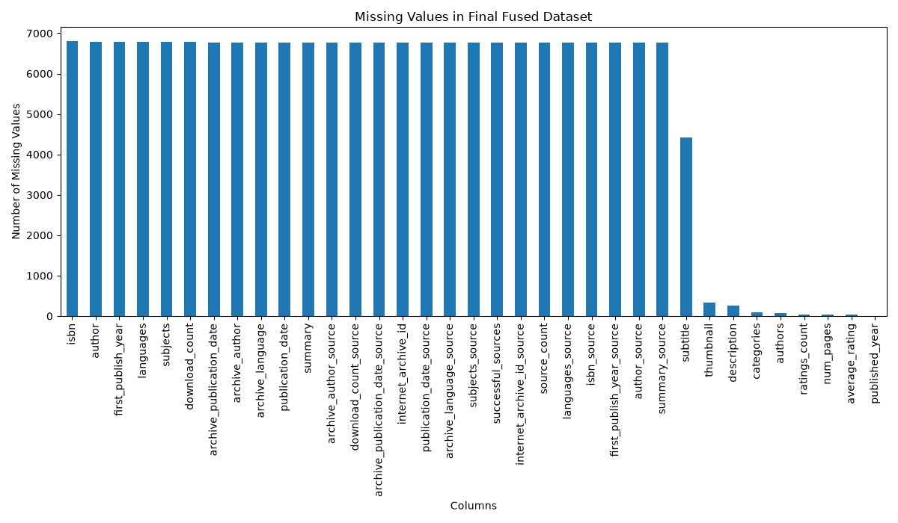

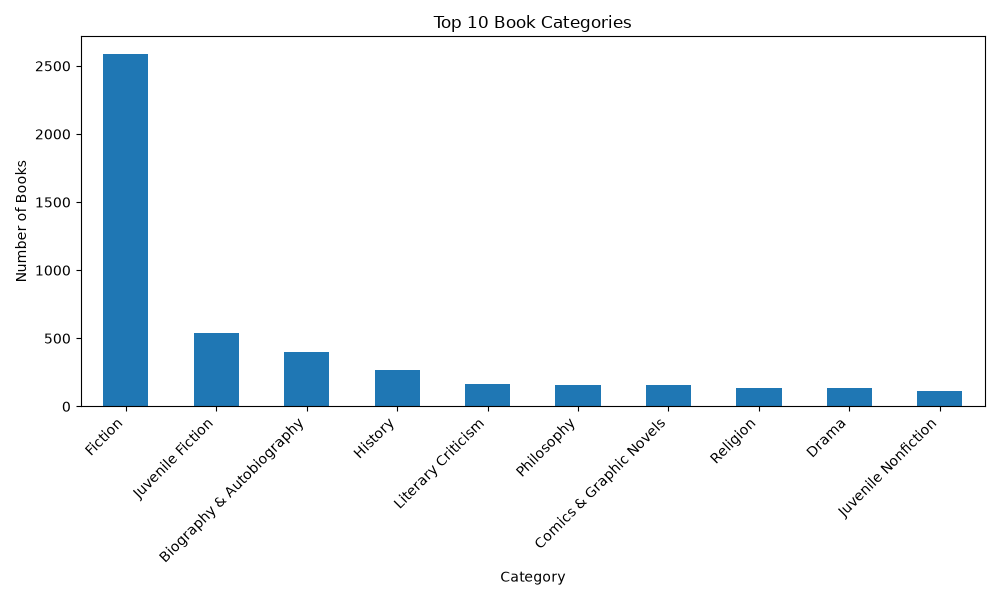

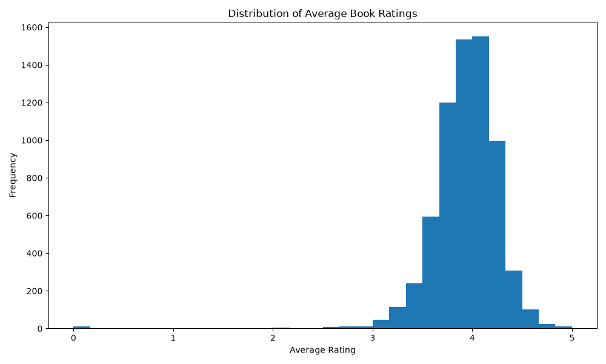

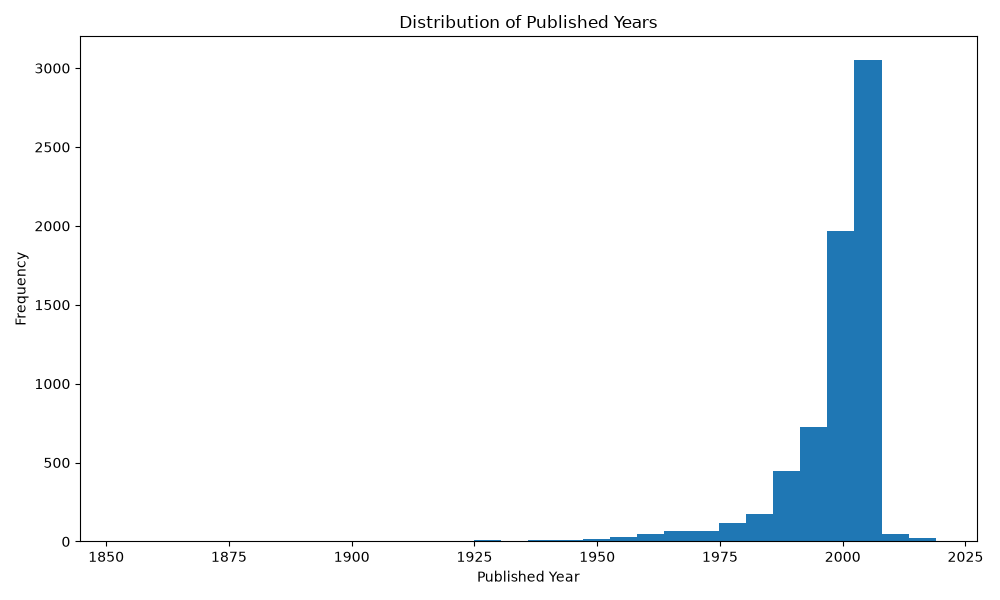

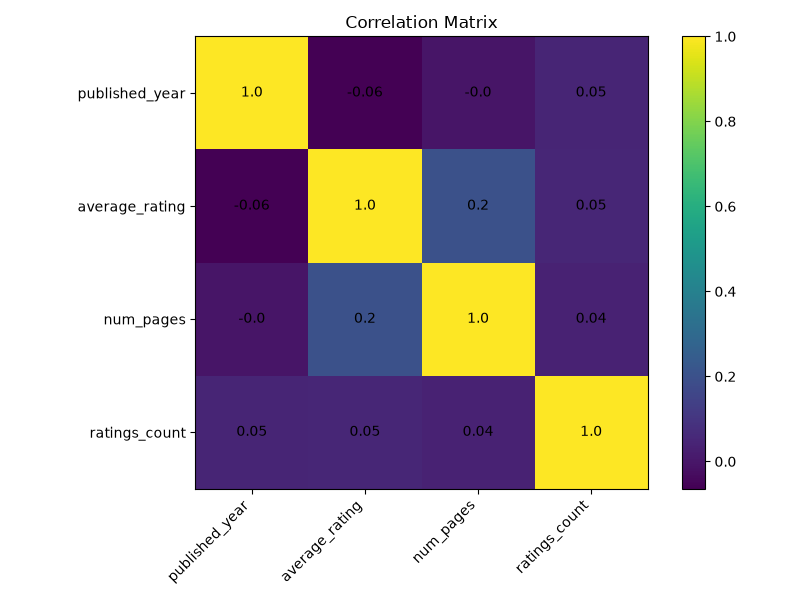

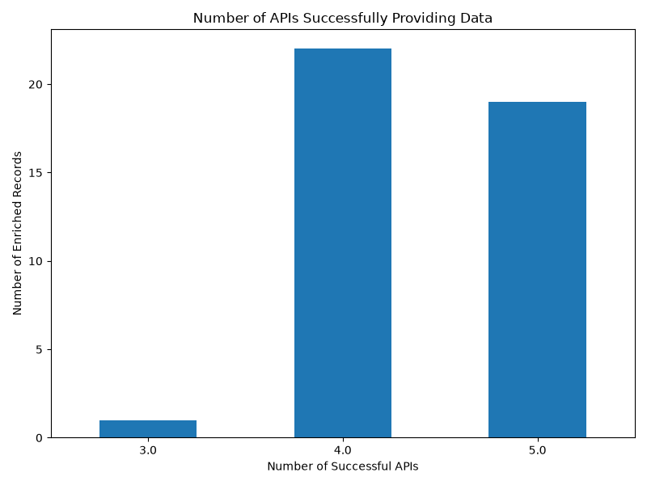

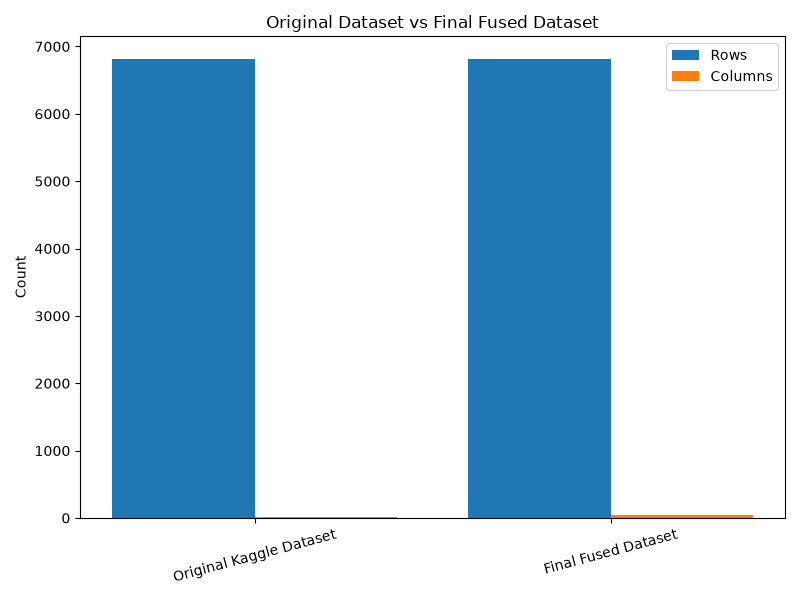

---

## 🤖 Machine Learning Algorithms

The project includes eight algorithm implementations for classification and regression experiments.

| No. | Algorithm | Category |
|---|---|---|
| 1 | Naive Bayes | Classification |
| 2 | Support Vector Machine (SVM) | Classification |
| 3 | Decision Tree | Classification |
| 4 | Random Forest | Classification |
| 5 | Logistic Regression | Classification |
| 6 | Regression Analysis | Regression |
| 7 | Multiple Linear Regression | Regression |
| 8 | Polynomial Regression | Regression |

The implementations and experiment scripts are available in the `algorithms/` directory.

---

## 🛠️ Technology Stack

| Area | Technologies |
|---|---|
| Programming Language | Python |
| Frontend / Application | Streamlit |
| Generative AI | Groq, LLaMA 3.3-70B |
| Retrieval-Augmented Generation | RAG |
| Vector Search | FAISS |
| Embeddings | Text Embedding Models |
| Image Processing | OCR |
| Voice | Speech Input, gTTS |
| APIs | Wikipedia, Open Library, Google Books, Wikidata |
| Data Analysis | Pandas, NumPy |
| Visualization | Matplotlib, Seaborn |
| Machine Learning | Scikit-learn |
| Dataset Formats | CSV, JSON, XLSX |

---

## 📁 Project Structure

```text
MC2509_Ishita_Boghara/
│
├── algorithms/                 # Machine learning algorithm implementations
│
├── data/                       # Datasets, fused data and visualizations
│
├── eda_outputs/                # Exploratory data analysis outputs
│
├── screenshots/                # Application screenshots
│
├── app.py                      # Main Streamlit application
├── api_client.py               # API client utilities
├── book_handler.py              # Book-related processing
├── config.py                    # Application configuration
├── custom_api.py                # Custom API functionality
├── external_apis.py             # External API integrations
├── fusion_dataset.py            # Dataset fusion operations
├── dynamic_dataset.py           # Dynamic dataset operations
├── dynamic_dataset_writer.py    # Dynamic dataset writing
├── llm_handler.py               # LLM integration
├── ocr_processor.py             # OCR processing
├── rag_engine.py                # Retrieval-Augmented Generation
├── voice_handler.py             # Voice-related functionality
├── web_search.py                # Web search functionality
│
├── requirements.txt             # Python dependencies
└── README.md                    # Project documentation
```

---

## 🚀 Installation and Setup

### Prerequisites

- Python 3.12 (recommended)
- Git
- Groq API key
- Optional API keys depending on enabled integrations

### 1. Clone the College Repository

```bash
git clone https://github.com/MCA-Class-2025/MCA-Student-Applications-2025-2026.git
```

### 2. Navigate to the Project Folder

```bash
cd MCA-Student-Applications-2025-2026/MC2509_Ishita_Boghara
```

### 3. Create a Virtual Environment

**Windows:**

```powershell
python -m venv .venv
.venv\Scripts\activate
```

**Linux / macOS:**

```bash
python3 -m venv .venv
source .venv/bin/activate
```

### 4. Install Dependencies

```bash
pip install -r requirements.txt
```

### 5. Configure API Keys

Create a `.env` file in the project root and add the required credentials.

Example:

```env
GROQ_API_KEY=your_groq_api_key
OPENAI_API_KEY=your_openai_api_key
```

Only configure keys for integrations you intend to use and that your application requires.

### 6. Run the Application

```bash
streamlit run app.py
```

Open the local URL displayed in the terminal, usually:

```text
http://localhost:8501
```

---

## 🔐 Environment Variables

API credentials must be stored locally in environment variables or the appropriate secrets configuration.

**Never commit `.env`, API keys, passwords, or private credentials to GitHub.**

---

## 🔮 Future Enhancements

- Expand the book dataset and metadata coverage.
- Improve recommendation quality and personalization.
- Enhance multilingual AI conversations.
- Extend evaluation of data science and machine learning experiments.
- Improve retrieval quality and book-specific knowledge coverage.

---

## 👩‍💻 Author

**Ishita Boghara**

MCA Student  
SNDT Women's University

---

## 📌 Repository

This project is part of the MCA Student Applications repository.

[View BookMuse 2.0 — College GitHub Repository](https://github.com/MCA-Class-2025/MCA-Student-Applications-2025-2026/tree/main/MC2509_Ishita_Boghara)

---

⭐ If you find this project interesting, feel free to explore the code and its features!
