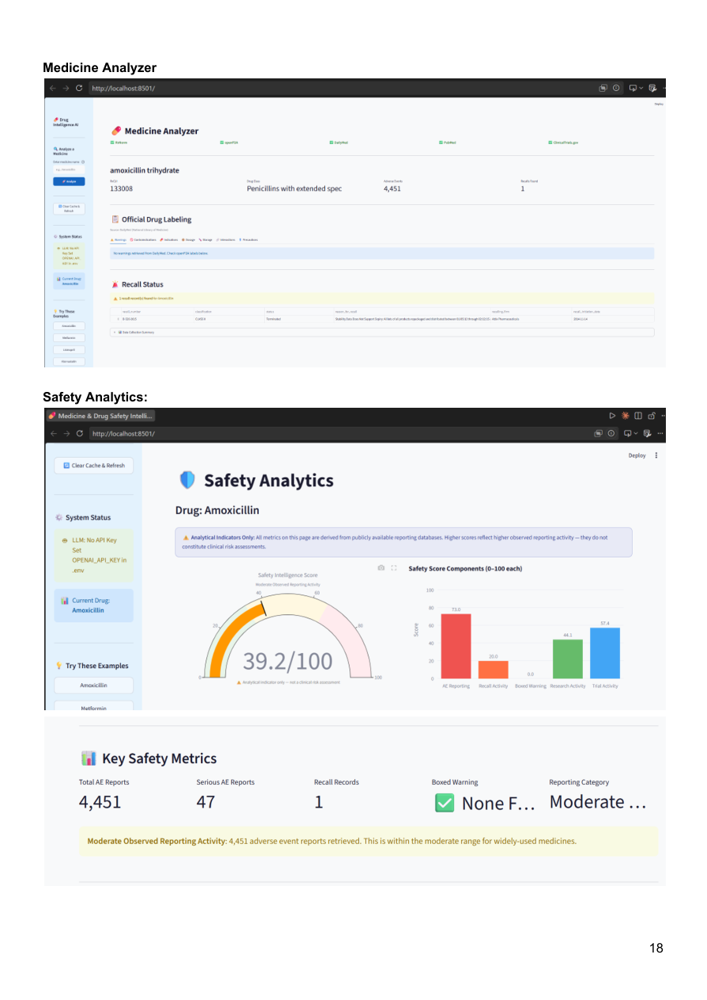
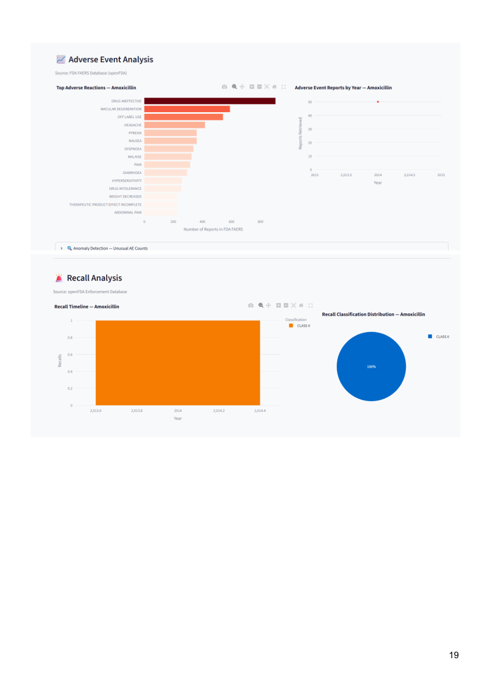
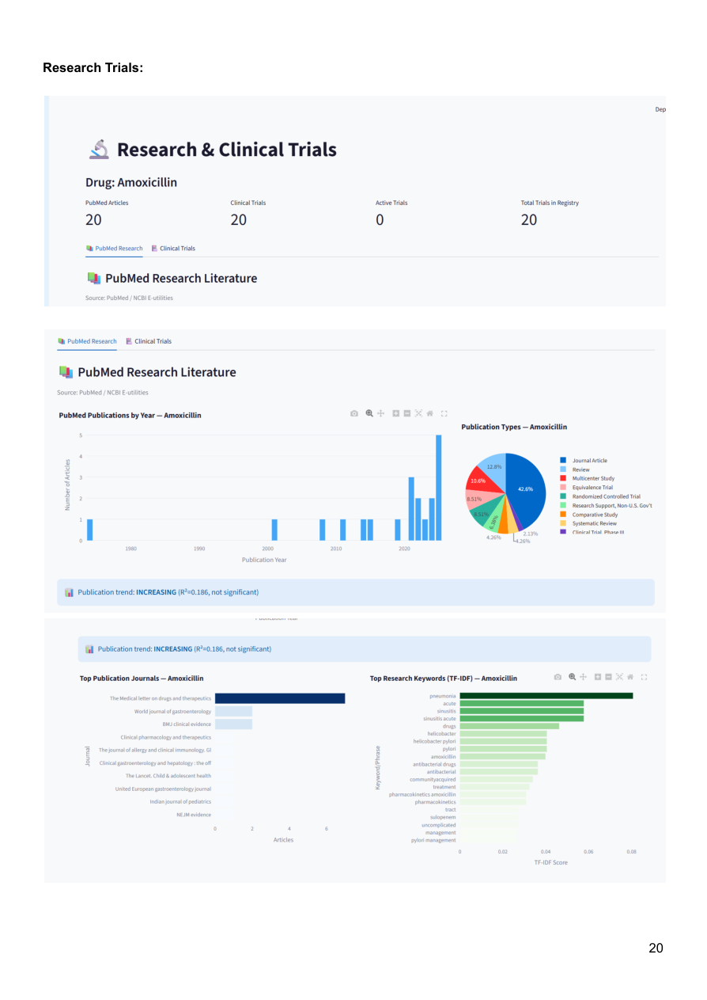
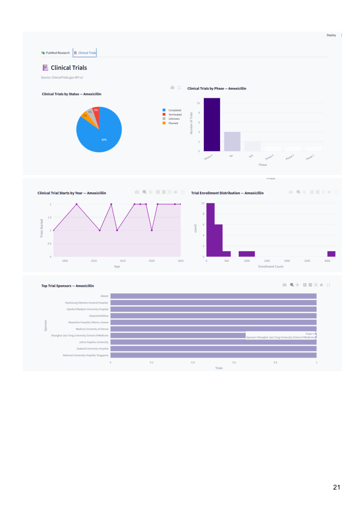
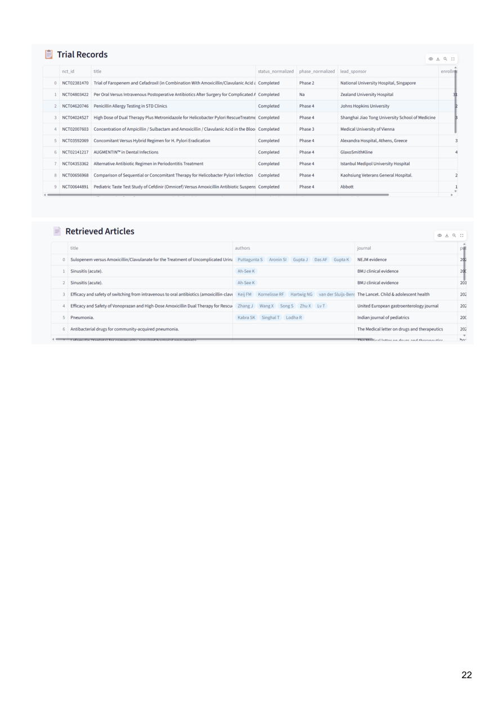
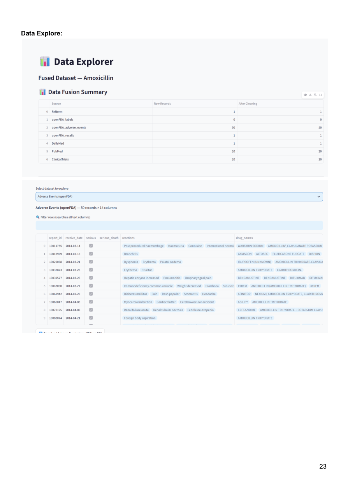
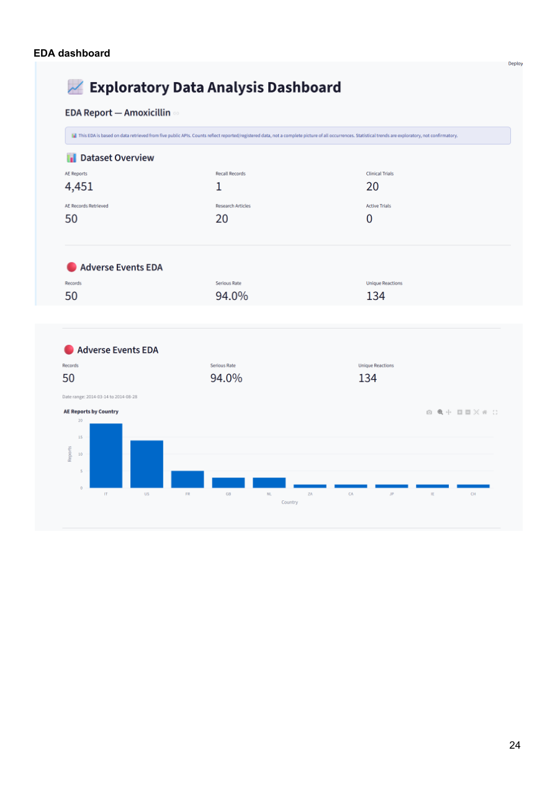
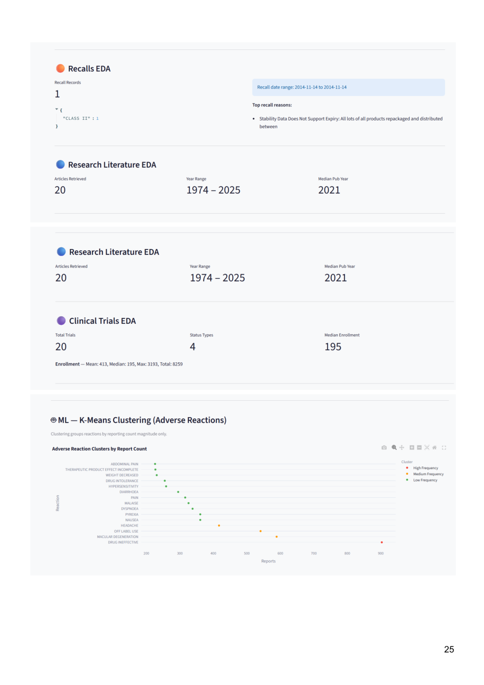

# Medicine & Drug Safety Intelligence AI

> Multi-source drug intelligence powered by Data Science, OCR, RAG and LLMs.

An academic Streamlit application that brings medicine information from five public healthcare data APIs into one place. It combines data collection, cleaning, normalization, fusion, exploratory analysis, machine-learning techniques, interactive visualizations and evidence-grounded question answering.

## Project Overview

Medicine safety information is spread across regulatory, medicine-label, biomedical research and clinical-trial databases. This project aims to make that information easier to explore by collecting and organizing data from trusted sources in a unified application.

The platform is intended for educational and research use. It does **not** diagnose medical conditions or provide clinical recommendations.

## Key Features

| Feature | Description |
|---|---|
| Multi-source API integration | Retrieves information from five public medicine and healthcare APIs |
| Drug normalization | Uses RxNorm to identify standardized medicine names and RxCUI values |
| Data cleaning and fusion | Cleans, normalizes and combines records from different sources |
| Safety analysis | Explores adverse-event reports, recalls and medicine-label warnings |
| Research and trials | Displays PubMed literature and ClinicalTrials.gov records |
| EDA dashboard | Summarizes datasets using statistics, distributions and trends |
| Machine learning | Includes K-Means clustering, Isolation Forest, PCA, TF-IDF and trend analysis |
| OCR medicine scanner | Uses image processing and Tesseract OCR to extract medicine text from uploaded images |
| RAG chatbot | Uses retrieved project data to support natural-language questions with source references |
| Interactive visualizations | Uses Plotly charts in the Streamlit interface |

## APIs and Data Sources

1. **openFDA** — adverse-event reports, drug recalls/enforcement actions and drug-label information.  
   Base URL: <https://api.fda.gov>
2. **RxNorm** — standardized medicine names, RxCUI lookup, brand/generic relationships and ingredient information.  
   Base URL: <https://rxnav.nlm.nih.gov/REST>
3. **DailyMed** — Structured Product Label (SPL) information, including warnings, contraindications, dosage and storage details.  
   Base URL: <https://dailymed.nlm.nih.gov/dailymed/services/v2>
4. **PubMed / NCBI E-utilities** — biomedical research article metadata, abstracts and publication information.  
   Base URL: <https://eutils.ncbi.nlm.nih.gov/entrez/eutils>
5. **ClinicalTrials.gov API v2** — clinical study status, phases, conditions, enrollment and sponsor information.  
   Base URL: <https://clinicaltrials.gov/api/v2>

## Technology Stack

- **Language:** Python 3.10+
- **Application:** Streamlit
- **Data processing:** Pandas, NumPy
- **Machine learning and NLP:** Scikit-learn, TF-IDF, K-Means, Isolation Forest, PCA
- **Visualization:** Plotly
- **OCR:** OpenCV, Tesseract, pytesseract
- **RAG and vector search:** sentence-transformers, FAISS
- **LLM integration:** Groq (model configured through environment variables)
- **Storage:** JSON, Parquet, CSV and FAISS index files
- **Utilities:** requests, asyncio/concurrent requests, Loguru, python-dotenv

## System Workflow

```text
Medicine name or uploaded medicine image
                 |
                 v
       OCR extraction (if image)
                 |
                 v
       RxNorm normalization
          (canonical name/RxCUI)
                 |
                 v
       Query external data APIs
                 |
                 v
       Raw JSON responses
                 |
                 v
       Cleaning and normalization
                 |
                 v
       Entity matching and data fusion
                 |
                 v
        Unified drug information
          /       |        \
         v        v         v
       EDA/ML  Visuals    Documents
                            |
                            v
                    Chunking + embeddings
                            |
                            v
                       FAISS search
                            |
                            v
                    LLM response with
                    retrieved evidence
```

## Machine Learning and Data Analysis

| Technique | Purpose |
|---|---|
| K-Means clustering | Groups similar adverse-event records |
| Isolation Forest | Flags unusual patterns in available data |
| PCA | Reduces feature dimensions for analysis/visualization |
| TF-IDF | Extracts important terms from text such as research abstracts |
| Linear Regression | Supports trend analysis |
| Descriptive statistics | Summarizes numeric fields and distributions |

These methods are exploratory. A detected cluster or anomaly is not proof of causation or a clinical safety conclusion.

## Screenshots

### Medicine Analyzer and Safety Analytics


### Adverse Events and Recall Analysis


### Research and Clinical Trials


### Clinical Trial Analytics


### Trial and Research Records


### Data Explorer


### Exploratory Data Analysis Dashboard


### EDA and Machine Learning Analysis


## Installation and Local Setup

### Prerequisites

- Python 3.10 or newer
- Git
- Tesseract OCR installed locally if you want to use the OCR functionality

**Windows Tesseract installer:** <https://github.com/UB-Mannheim/tesseract/wiki>

### Run the application

Open PowerShell or Command Prompt in the project directory:

```powershell
# Create a virtual environment
python -m venv venv

# Activate it (Windows PowerShell)
.\venv\Scripts\Activate.ps1

# Install dependencies
pip install -r requirements.txt

# Start the Streamlit application
streamlit run app.py
```

Then open the local URL printed in the terminal, normally `http://localhost:8501`.

### Environment variables

Create a `.env` file in the project root and add the keys/settings required by your local configuration. For example:

```env
GROQ_API_KEY=your_groq_api_key
GROQ_MODEL=openai/gpt-oss-120b
OPENFDA_API_KEY=
PUBMED_EMAIL=your_email@example.com
CACHE_TTL=3600
```

Do not commit `.env` or real API keys to GitHub. If the project uses Streamlit Community Cloud, configure secrets in the app's settings instead.

## Documentation

The accompanying project/API documentation is included in [`docs/API_and_Project_Documentation.pdf`](docs/API_and_Project_Documentation.pdf).

## Limitations

- Data availability varies by medicine and by source; some APIs may return no matching records.
- Public datasets can be updated after a local copy or cached response has been collected.
- OCR results depend on the quality and readability of the uploaded image.
- API rate limits and network availability may affect retrieval.
- RAG can still produce incomplete or incorrect responses; verify important information against the linked official sources.
- Tesseract must be installed separately for local OCR use.

## Medical Safety Disclaimer

This application is an academic information and research tool only. It is **not** a medical diagnosis system, does not prescribe medication, and does not provide clinical recommendations. It is not a substitute for professional medical advice. Do not start, stop or change medication based on this application. Always consult a qualified healthcare professional for medical decisions.

## Academic Submission

Place this project folder inside the class repository using the required naming format:

```text
MC2515_TanveeDesai
```

Include the required files in that folder:
- Excel file before data fusion
- Fused Excel file
- Application source code
- API documentation PDF/DOC

