# PolicyPal — Company Policy AI Bot

> RAG-based company policy assistant with a five-API data-fusion layer for Data Science and Analytics.

An academic Streamlit application that answers employee questions from company policy documents using Retrieval-Augmented Generation. A separate data-fusion pipeline collects holiday, currency, weather, country and HR-news data from five public APIs. It cleans and fuses that data into one Excel dataset used for data-quality assessment, exploratory analysis and future machine-learning work.

## Project Overview

Employees often need to search several long policy documents for a simple answer. PolicyPal indexes the company's policy documents, retrieves the passages relevant to a question, and passes them to an LLM so that the answer is grounded in the official policy.

The data-fusion layer adds real-world context, such as the next public holiday, the local currency rate, the city's weather for work-from-home decisions, and recent HR and labour news. It also turns this context into a structured dataset for analytics.

The knowledge base belongs to a **fictional company (NimbusTech Solutions)** and is synthetic. Real company handbooks are confidential.

The platform is intended for educational use. It does **not** replace HR, legal or management advice.

## Key Features

| Feature | Description |
|---|---|
| Policy question answering (RAG) | Retrieves relevant policy chunks and generates grounded answers with source excerpts |
| Multi-format ingestion | Loads `.md`, `.txt`, `.csv`, `.pdf` and `.docx` policy files |
| Header-aware chunking | Splits documents by section so each chunk stays on one topic |
| Semantic search | Cohere embeddings (1,024 dimensions) stored in a FAISS vector index |
| Coverage indicator | Each answer is tagged FULL / PARTIAL / NONE depending on how well the policies cover the question |
| Photo mode | Ask about a photographed notice or memo using a Groq vision model |
| Live context panels | Public holidays, currency, WFH weather advisory, employer-country info, HR news |
| Five-API data fusion | Builds `PolicyPal_Master_Dataset.xlsx` from five APIs, with caching and status capture |
| Data-quality assessment | Missing values, duplicates, malformed records, consistency, relevance and outliers |
| EDA charts | Charts generated from the project's own data files |

## APIs and Data Sources

### Original dataset (knowledge base)

| File | Format | Content |
|---|---|---|
| `leave_and_attendance_policy.md` | Markdown | Casual, sick, earned, maternity and paternity leave |
| `remote_work_policy.md` | Markdown | Hybrid eligibility, equipment, security |
| `expense_and_travel_policy.md` | Markdown | Reimbursement, per-diem, travel booking |
| `it_security_policy.md` | Markdown | Passwords, MFA, data classification, incidents |
| `code_of_conduct_policy.md` | Markdown | Ethics, harassment, conflicts of interest |
| `hr_faqs.csv` | CSV | 20 question / answer / category records |

These 6 files hold about 3,000 words and are indexed as 48 RAG chunks.

### Data-fusion APIs

1. **countries.dev** — country name, capital, region, population, area, currency and timezone.
   Base URL: <https://countries.dev>
2. **ExchangeRate-API** — current USD exchange rates (166 currencies).
   Base URL: <https://open.er-api.com/v6>
3. **Open-Meteo** — city geocoding and current weather (temperature, precipitation, wind, WMO weather code).
   Base URLs: <https://geocoding-api.open-meteo.com/v1> and <https://api.open-meteo.com/v1>
4. **Nager.Date** — public holidays by country and year.
   Base URL: <https://nagerholidays.com/api/v4>
5. **NewsData.io** — HR, labour and workplace news by country and policy topic (API key required).
   Base URL: <https://newsdata.io/api/1>

### AI services

- **Groq**: answer generation (`openai/gpt-oss-120b`) and photo mode (vision model configured in `src/vision.py`)
- **Cohere**: text embeddings (`embed-english-v3.0`)

## Technology Stack

- **Language:** Python 3.10+
- **Application:** Streamlit
- **RAG:** Cohere embeddings, FAISS (`faiss-cpu`), Groq LLM
- **Document processing:** pypdf, python-docx
- **Data processing:** pandas, NumPy
- **Excel output:** openpyxl
- **Visualisation (reports):** matplotlib
- **Utilities:** requests, httpx
- **Storage:** Markdown/CSV (knowledge base), FAISS index, JSON API cache, Excel workbooks

## System Workflow

```text
                 Employee question (text or photo)
                                |
                                v
                Photo mode: Groq vision reads the image
                                |
                                v
             Question embedding (Cohere) -> FAISS search
                                |
                                v
                Relevant policy chunks (with sources)
                                |
                                v
        Prompt = question + policy context (+ live API context)
                                |
                                v
                 Groq LLM -> answer + coverage + sources


   Data-fusion pipeline (src/policy_data_fusion.py)

   Config: 10 countries x 5 cities x 10 policy topics
                                |
        +----------+------------+-----------+-----------+
        |          |            |           |           |
   countries.dev  ExchangeRate  Open-Meteo  Nager.Date  NewsData.io
        |          |            |           |           |
        +----------+------------+-----+-----+-----------+
                                      |
                                      v
                Raw JSON cached in data/api_cache/
                                      |
                                      v
        Parse -> source tables (Before_Fusion workbook)
                                      |
                                      v
      Fuse on country_code / city / policy_topic / currency_code
                                      |
                                      v
         data/PolicyPal_Master_Dataset.xlsx (2,025 x 36)
                                      |
                                      v
               Data-quality assessment + EDA (reports/phase1)
```

## Phase 1 Results (Parts A–E)

| Measure | Value |
|---|---|
| Original knowledge base | 6 files, 48 RAG chunks |
| API requests in the collection run | 221 |
| Before-fusion workbook | 11 sheets (knowledge base, 6 API tables, 2 request logs, README) |
| Fused dataset | 2,025 rows × 36 columns |
| News articles behind the fused rows | 405 (each expanded to 5 cities) |
| Countries with fused rows | 6 of 10 |
| Fusion validation | All checks passed (row count, unique IDs, 0 attribute mismatches) |

| API | Requests returning data |
|---|---|
| countries.dev | 10 / 10 |
| ExchangeRate-API | 1 / 1 |
| Open-Meteo (geocoding / forecast) | 50 / 50 and 50 / 50 |
| Nager.Date | 8 / 10 (India and UAE: HTTP 204, no data) |
| NewsData.io | 52 / 100 (no successful response from request 55 onward) |

Because NewsData.io drives row creation, the UAE, Germany, France and Japan have no rows in the fused dataset. These outcomes are reported exactly as recorded.

### Data Quality and Analysis

| Check | Finding |
|---|---|
| Missing values | `holiday_type` is empty in 100% of rows (parser reads `types`, the API returns `holidayTypes`); 435 India rows have no holiday |
| Duplicates | 0 duplicate IDs or rows; 37 articles repeated across topics; each article appears 5 times by design (one row per city) |
| Malformed / inconsistent | HTTP 204 responses, long official country names, paid-plan placeholder text in the news `content` field (ignored) |
| Quality flag | `data_quality_flag` marks every row COMPLETE, including rows with no holiday |
| Relevance | Only 11.1% of news titles contain the policy-topic keyword |
| Outliers | Weather values are plausible; Dubai, Abu Dhabi and Al Ain are above the 42 °C severe-heat threshold |

These checks are exploratory. A flagged value is reviewed before any change is made to the data.

## Screenshots

All screenshots are stored in the [`screenshots/`](screenshots/) folder.

### Knowledge Base — Policy Documents
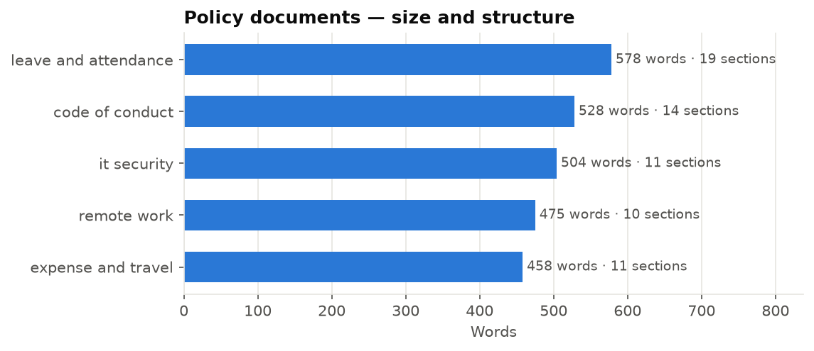

### Data Fusion — API Outcome per Source
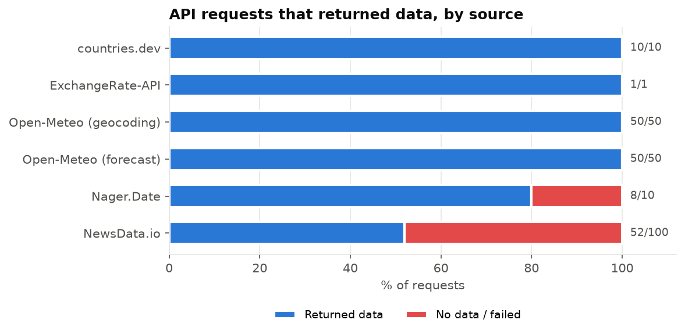

### NewsData Requests by Country and Topic
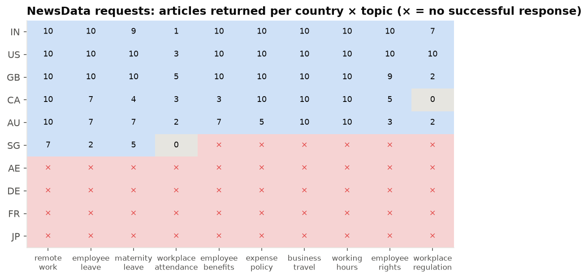

### Fused Rows per Country
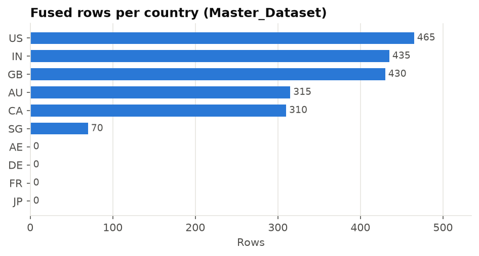

### News Articles per Policy Topic
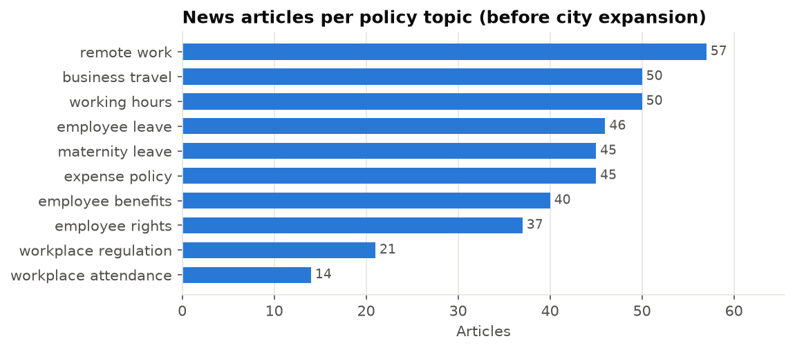

### Public Holidays per Country
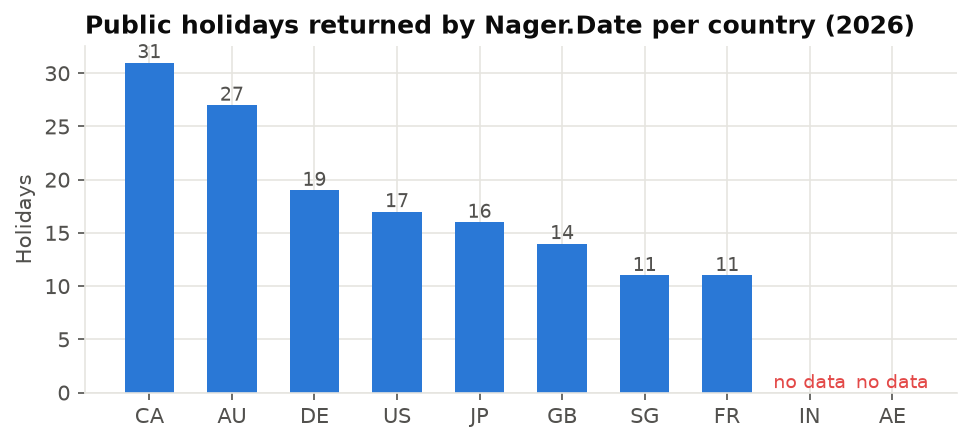

### Missing Values in the Fused Dataset
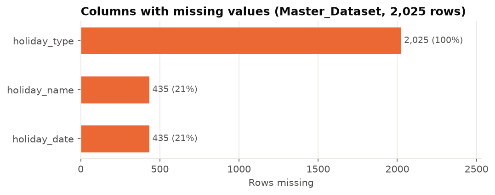

### News Topic Relevance
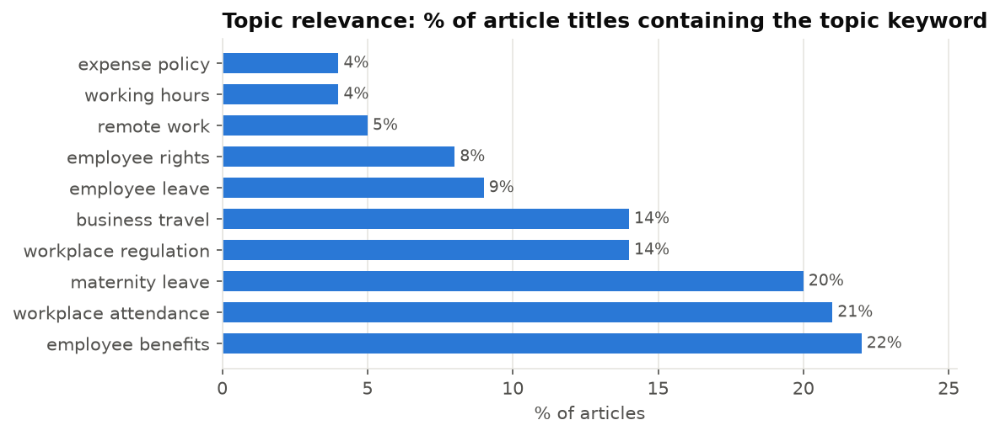

### Home Page
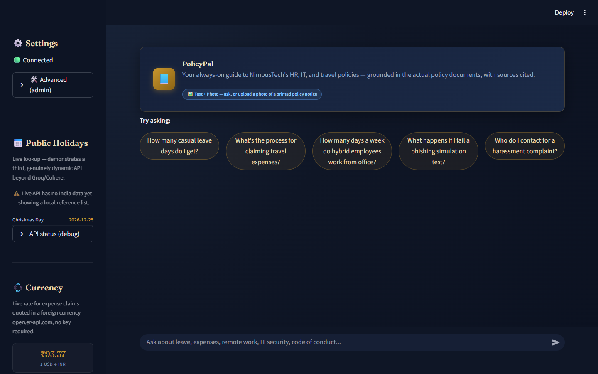

### Policy Upload
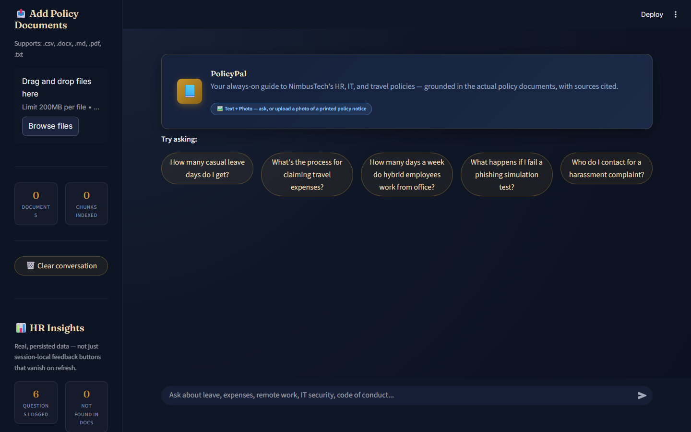

### User Query
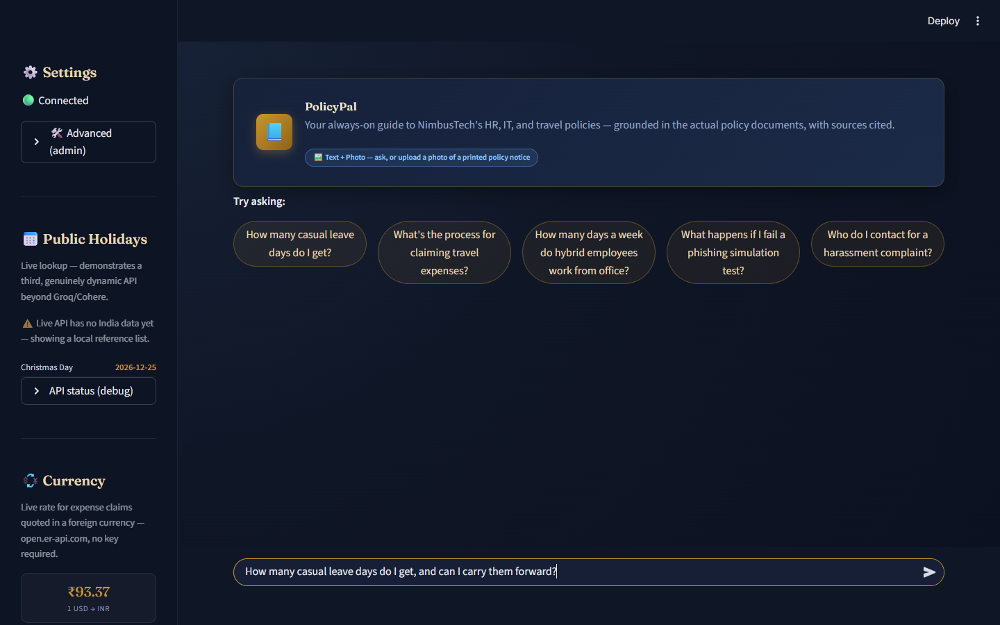

### AI-Generated Response
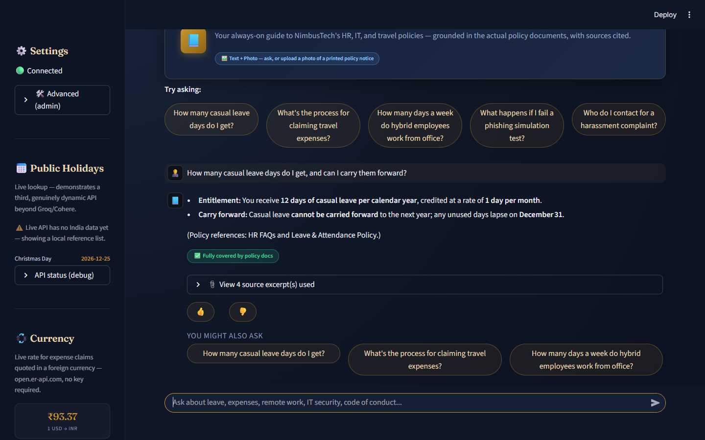

### Data Science Dataset Panel
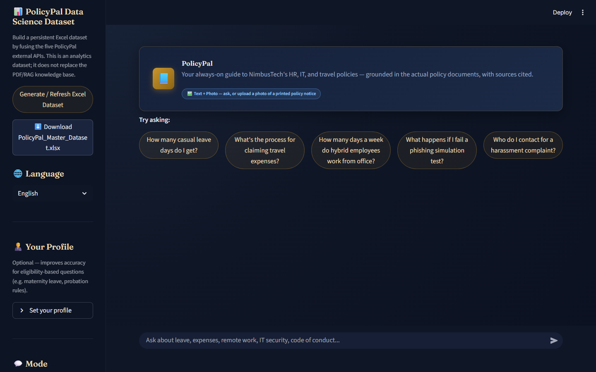

## Fused Dataset Workbook

`data/PolicyPal_Master_Dataset.xlsx` contains five sheets:

| Sheet | Content |
|---|---|
| `Master_Dataset` | Fused observations: one row per city + news article + policy topic (2,025 × 36) |
| `Holiday_Calendar` | Every public holiday returned per country (146 rows) |
| `Data_Dictionary` | Description and source of each of the 36 columns |
| `API_Run_Log` | Run timestamp, request count, cache status |
| `Dataset_Summary` | Purpose and design notes |

The dataset is **not inserted into the RAG prompt automatically**. Policy answers stay grounded in the official policy documents. The workbook is for data cleaning, feature engineering, EDA, analytics and future ML work.

## Project Structure

```text
policy-chatbot-v8/
├── app.py                         # Streamlit application
├── requirements.txt
├── .env.example                   # variable names only - no real keys
├── .streamlit/
│   ├── config.toml
│   └── secrets.toml.example
├── src/
│   ├── data_processing.py         # loading, cleaning, chunking
│   ├── embeddings.py              # Cohere embeddings
│   ├── vector_store.py            # FAISS index
│   ├── rag_pipeline.py            # retrieval + Groq generation
│   ├── vision.py                  # photo mode
│   ├── context_apis.py            # live API panels in the app
│   ├── fusion_config.py           # countries, cities, topics, columns
│   ├── policy_data_fusion.py      # five-API collection + fusion
│   └── analytics.py               # interaction analytics
├── scripts/build_index.py         # builds the FAISS index
├── data/
│   ├── raw/                       # original knowledge base
│   ├── api_cache/                 # raw API JSON (cached)
│   ├── PolicyPal_Before_Fusion_Source_Tables.xlsx
│   └── PolicyPal_Master_Dataset.xlsx
├── vectorstore/                   # index.faiss, metadata.pkl
├── reports/phase1/                # Parts A-E report, charts, scripts
└── screenshots/                   # charts and app screenshots used in this README
```

## Installation and Local Setup

### Prerequisites

- Python 3.10 or newer
- Git
- API keys for Groq, Cohere and NewsData.io (all three have free tiers)

### Run the application

Open PowerShell or Command Prompt in the project directory:

```powershell
# Create a virtual environment
python -m venv venv

# Activate it (Windows PowerShell)
.\venv\Scripts\Activate.ps1

# Install dependencies
pip install -r requirements.txt

# Build the FAISS index from data/raw (first run only)
python scripts/build_index.py

# Start the Streamlit application
streamlit run app.py
```

Then open the local URL printed in the terminal, normally `http://localhost:8501`.

### Build the data-fusion dataset

```powershell
$env:NEWSDATA_API_KEY = "your_newsdata_key"
python -m src.policy_data_fusion
```

You can also use **Generate / Refresh Excel Dataset** in the app's *PolicyPal Data Science Dataset* section. Cached responses in `data/api_cache/` are reused, so re-runs do not spend API credits again.

### Regenerate the Phase 1 report (no API calls)

```powershell
python reports/phase1/build_phase1_assets.py
npm install docx
node reports/phase1/build_report.js
```

### Environment variables

Create a `.env` file, or `.streamlit/secrets.toml` for Streamlit, in the project root:

```env
GROQ_API_KEY=your_groq_api_key
COHERE_API_KEY=your_cohere_api_key
NEWSDATA_API_KEY=your_newsdata_api_key
```

Do not commit `.env`, `secrets.toml` or real API keys to GitHub. `.env.example` should contain only the variable names. If you deploy on Streamlit Community Cloud, configure the keys in the app's **Secrets** settings.

## Documentation

- Phase 1 report (Parts A–E): [`reports/phase1/PolicyPal_Phase1_Parts_A-E_Report.docx`](reports/phase1/PolicyPal_Phase1_Parts_A-E_Report.docx)
- Dataset before fusion: [`data/PolicyPal_Before_Fusion_Source_Tables.xlsx`](data/PolicyPal_Before_Fusion_Source_Tables.xlsx)
- Fused dataset: [`data/PolicyPal_Master_Dataset.xlsx`](data/PolicyPal_Master_Dataset.xlsx)
- Knowledge-base description: [`data/DATASET_DESCRIPTION.md`](data/DATASET_DESCRIPTION.md)

## Limitations

- The knowledge base is synthetic and small (6 files); its figures are illustrative, not real HR guidance.
- NewsData.io free-plan limits stopped the run after 54 requests, so 4 of 10 countries have no fused rows.
- Nager.Date returned no data for India and the UAE, and a parsing bug leaves `holiday_type` empty.
- News queries match the full article text, so many results are only loosely related to the policy topic.
- The weather and currency values are snapshots from a single moment, not time series.
- Answer quality depends on retrieval; the LLM can still produce incomplete answers, so check important points against the policy text.
- External API availability and rate limits affect the live panels and the dataset build.

## Disclaimer

PolicyPal is an academic project. It is **not** an official HR, legal or compliance system and does not make employment decisions. The policy content belongs to a fictional company. External API data belongs to its providers and is subject to their terms of use. The fused dataset is analytical context and is **not** automatically inserted into answers: policy answers stay grounded in the official policy documents. Always confirm important policy questions with your HR department.

## Academic Submission

Place this project folder inside the class repository using the required naming format:

```text
<RollNumber>_<StudentName>
```

Include the required files in that folder:
- Excel file before data fusion: `data/PolicyPal_Before_Fusion_Source_Tables.xlsx`
- Fused Excel file: `data/PolicyPal_Master_Dataset.xlsx`
- Application source code: `app.py`, `src/`, `scripts/`
- API and project documentation (`reports/phase1/`)
- Screenshots (`screenshots/`)
