# AI Career Assistant 💼

**LLM Application with API Data Fusion | MCA Project Submission**

| | |
|---|---|
| **Student** | Shravani Lonkar |
| **Roll Number** | MC2535 |
| **Course** | MCA |
| **Project** | AI Career Assistant — resume analysis, job matching and career guidance |

---

## 📌 About the Project

AI Career Assistant is a Streamlit web application that helps a candidate understand how well their resume fits a job. The user uploads a resume and a job description, and the app uses an LLM with retrieval (RAG) to produce a resume analysis, ATS-style feedback, a skill-gap report, interview questions, and job recommendations.

The application also includes a **Career Intelligence Dashboard** built on a **fused dataset** of 750 records, created by combining a resume/job dataset with data collected from external APIs.

## ✨ Main Features

- **Dashboard** — Career Intelligence Dashboard with KPIs, ATS-score distribution, skills, salary, location and data-quality views, with filters for job role, location, work mode, job type and experience.
- **Upload & Analyze** — upload a resume and a job description (PDF) and run the analysis.
- **Resume Report** — AI analysis, skill match (matched / missing / extra skills) and a resume health check.
- **Interview Prep** — AI-generated HR and technical questions, a role-based question bank and a practice mode.
- **Chat With Resume** — ask questions about your resume and the target job (RAG over resume + job description).
- **Voice Assistant** — ask a question by voice; it is transcribed and answered from your resume.
- **Job Recommendations** — search jobs through the fusion API, or browse the offline dataset.
- **Skills Lab** — demand vs supply of skills, role × skill heatmap, and a role matcher.
- **Salary & Market** — salary by work mode, location and experience.
- **Data Explorer** — browse the fused dataset, source sheets, individual candidates and the architecture.

## 📸 Application Screenshots

### Career Intelligence Dashboard

**1. Dashboard — Overview**

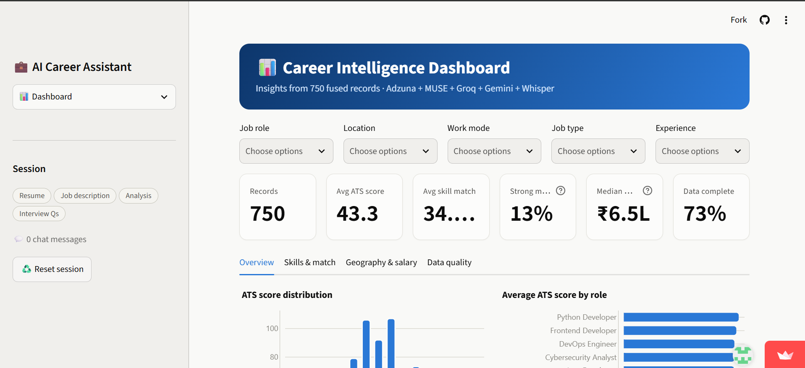

**2. ATS score distribution and average ATS score by role**

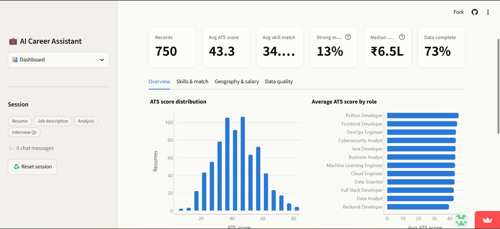

**3. Job type by work mode and most common AI feedback**

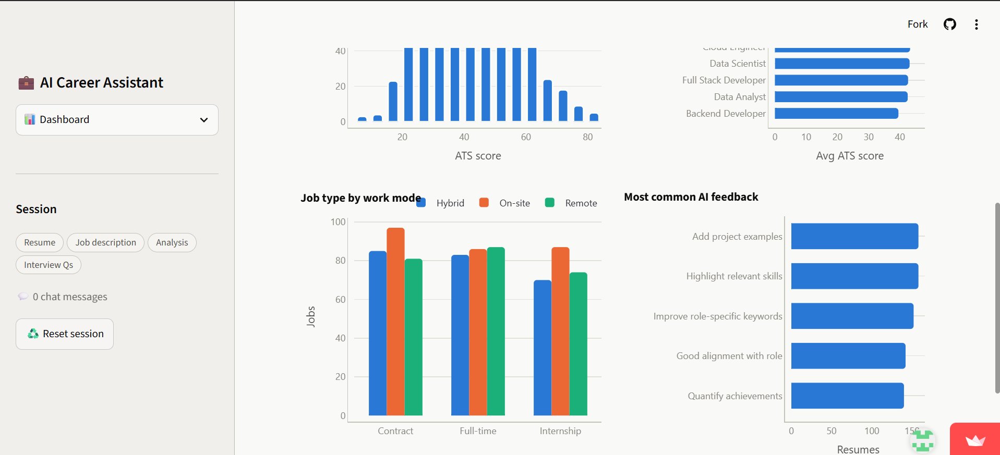

**4. Skills & match — skill match vs ATS score, role × experience heatmap**

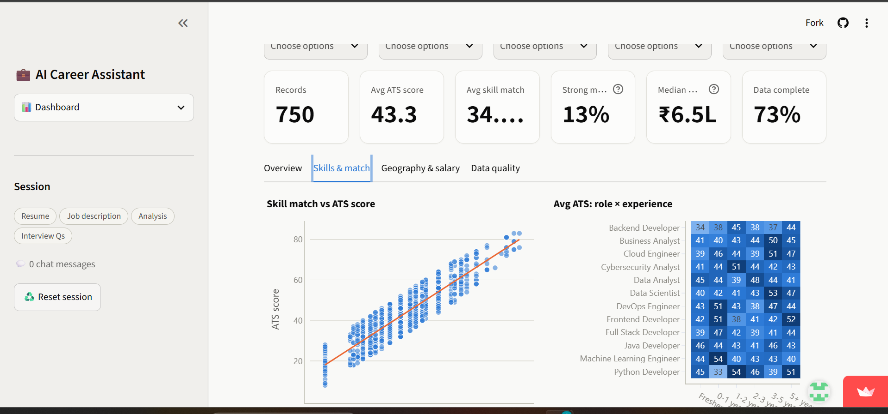

**5. Experience & education fit, and top 10 missing skills**

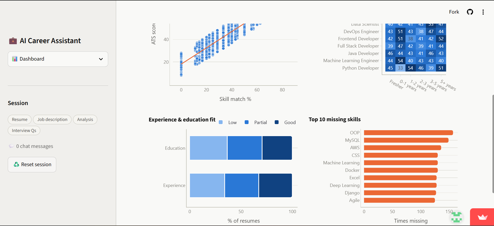

**6. Geography & salary — jobs by location and salary range by role**

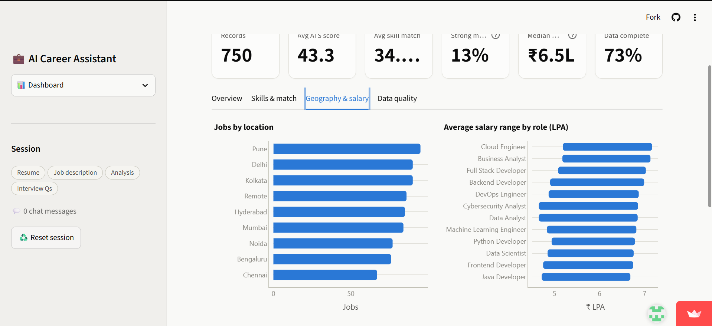

**7. Data quality — fusion source combinations and job sources**

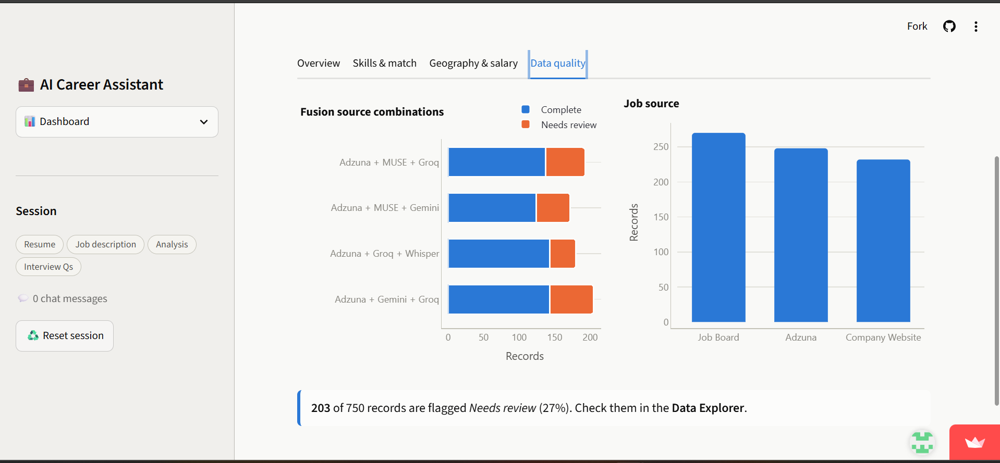

### Resume Analysis

**8. Upload & Analyze**

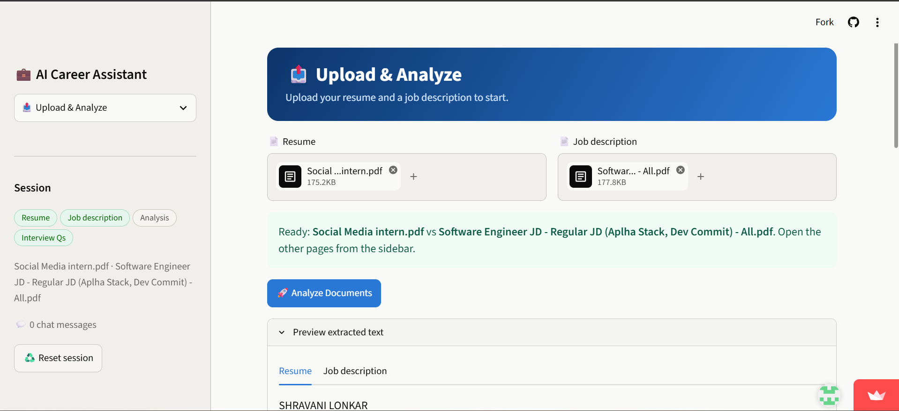

**9. Resume Report**

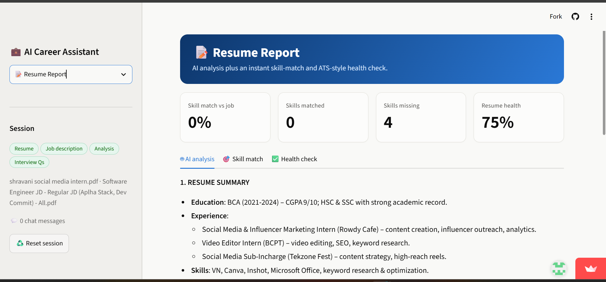

### Interview Preparation, Chat and Voice

**10. Interview Prep**

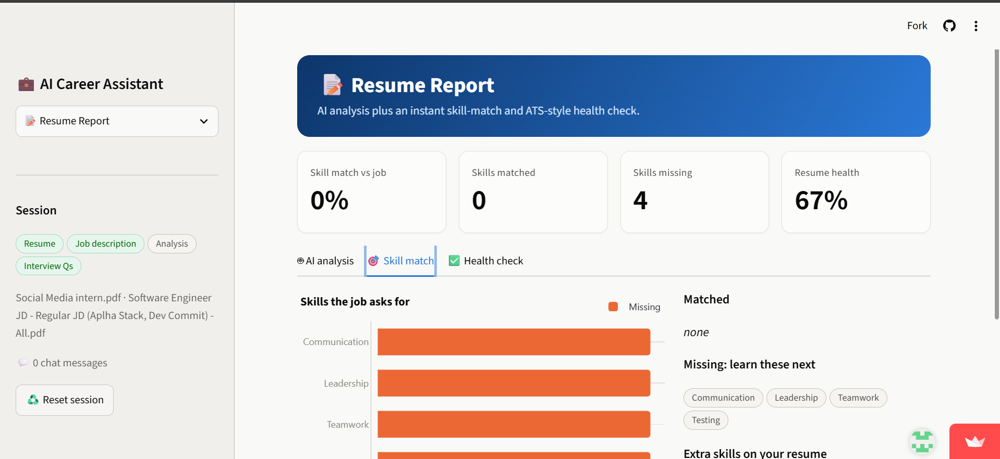

**11. Chat With Resume**

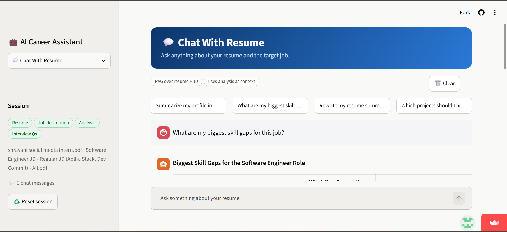

**12. Voice Assistant**

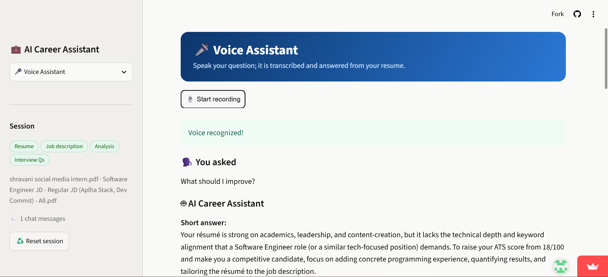

### Jobs, Skills and Salary

**13. Job Recommendations**

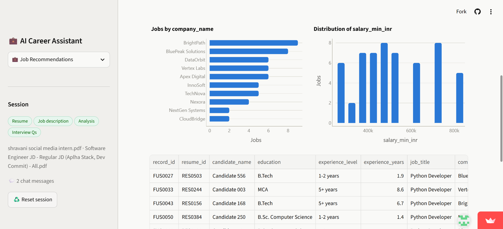

**14. Skills Lab — demand vs supply**

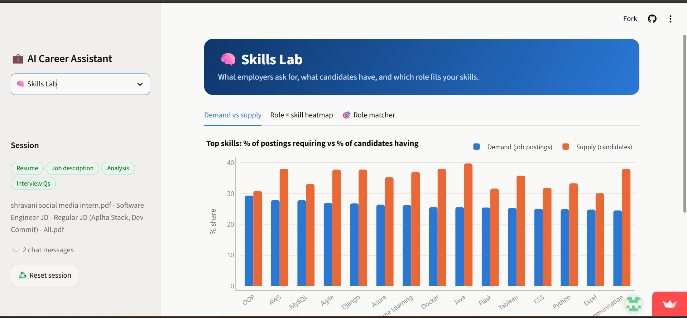

**15. Skills Lab — role × skill heatmap**

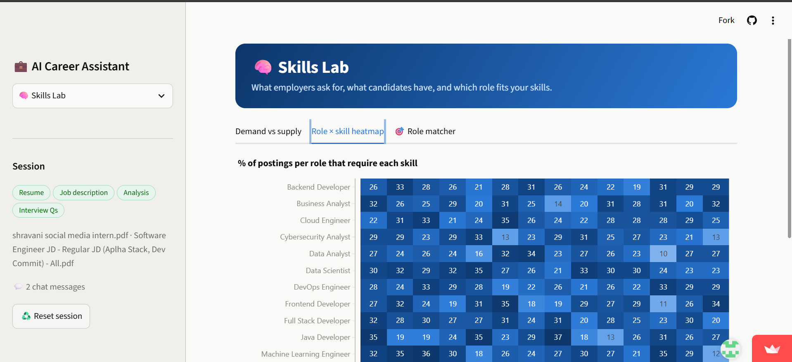

**16. Skills Lab — role matcher**

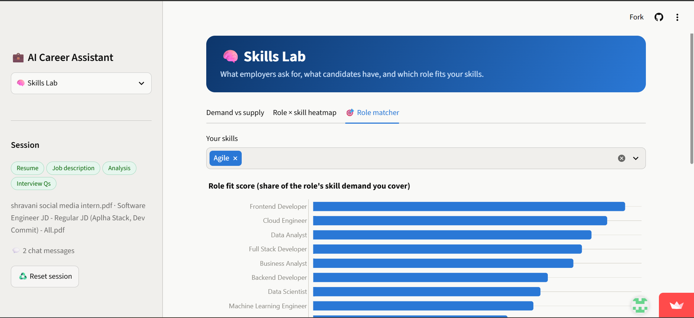

**17. Salary & Market**

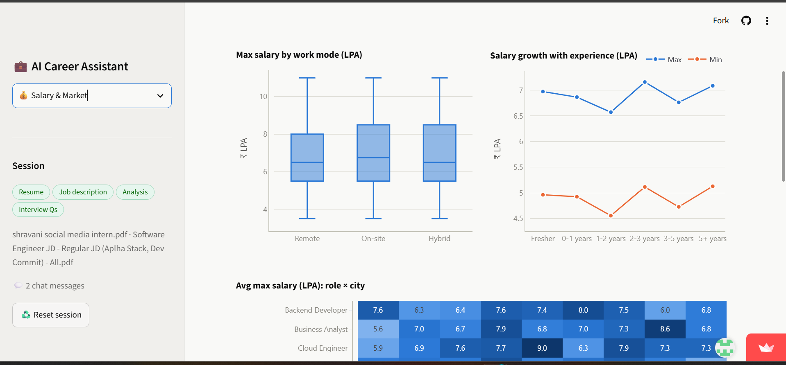

**18. Experience vs maximum salary (correlation 0.04)**

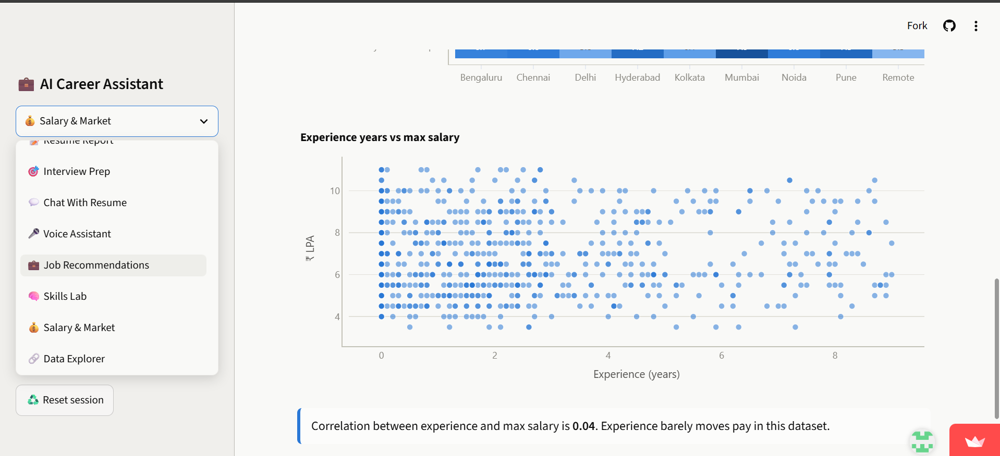

### Data Explorer

**19. Data Explorer — fused dataset**

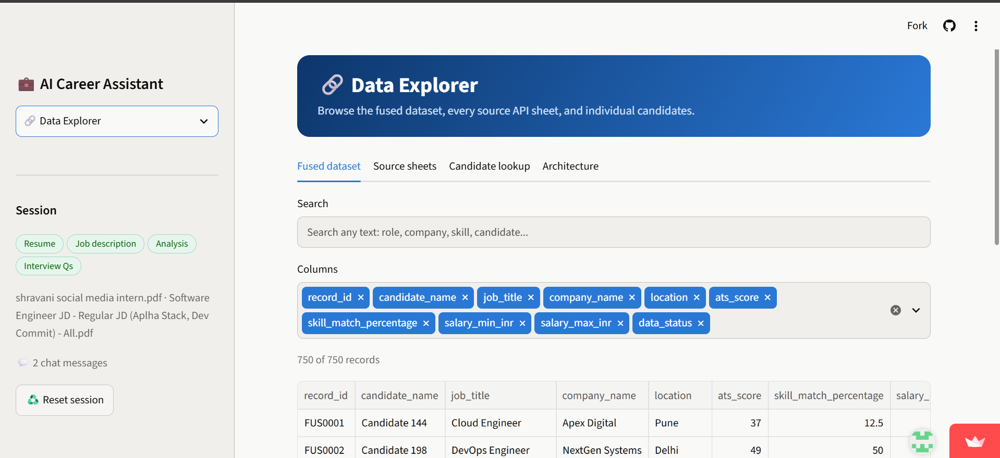

**20. Data Explorer — records table with CSV download**

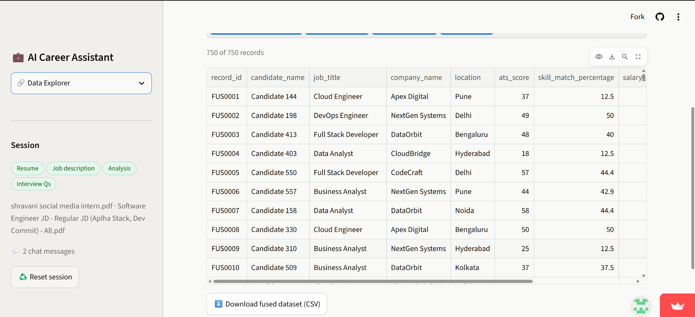

## 📊 Dashboard Highlights

Values shown on the Career Intelligence Dashboard for the fused dataset:

| Metric | Value |
|---|---|
| Fused records | 750 |
| Average ATS score | 43.3 |
| Strong-match share | 13% |
| Median salary | ₹6.5 LPA |
| Data completeness | 73% |
| Records flagged "Needs review" | 203 of 750 (27%) |

The Dashboard has four tabs: **Overview**, **Skills & match**, **Geography & salary** and **Data quality**.

## 🧰 Technology Stack

| Area | Technology |
|---|---|
| Programming language | Python |
| Web application | Streamlit |
| Main LLM | Llama 3.1 8B Instant via the **Groq API** |
| Additional LLM | **Google Gemini API** |
| Speech-to-text | **Groq Whisper API** |
| Job data | **The Muse API**, **Adzuna API** |
| Retrieval | RAG over resume + job description / career knowledge base |
| Data files | Excel / CSV |

## 🗃️ Dataset and Data Fusion

**Original datasets (Kaggle)**

- [Job Description Dataset](https://www.kaggle.com/datasets/ravindrasinghrana/job-description-dataset)
- [Mock Interview Questions](https://www.kaggle.com/datasets/muhammadwaleedkhalil/mock-interview-questions)

**Key attributes:** job title, skills, education, experience, job description, required skills, matching skills, missing skills and ATS score.

**Data fusion.** Resume/candidate data, the career/job dataset and API job data (The Muse, Adzuna) are combined using **Job Role / Skills as the common attribute**, because the sources have no shared unique ID. The fusion method is **Model-Based Predictive Enrichment**: skills are extracted from the resume, matched against the career/job data, and the record is enriched with an AI-generated recommended role and match score. Records are keyed by a Candidate ID so a repeated candidate is updated (upsert) instead of duplicated.

The full description of the dataset, APIs, fusion method, data-quality checks and EDA is in the report in [`docs/`](docs/).

## 🔌 External API Integrations

| API | Purpose |
|---|---|
| Groq API (Llama 3.1 8B Instant) | Fast LLM responses for career guidance, resume analysis and interview questions |
| Google Gemini API | LLM analysis of resume information and career recommendations |
| The Muse API | Job and career data used for recommendations and data fusion |
| Adzuna API | Live job search and job data for the fused dataset |
| Groq Whisper API | Voice-to-text for the Voice Assistant |
| OCR (resume text extraction) | Extracts text from scanned or image resumes |

## 📁 Folder Structure

The college repository asks for one folder named `RollNumber_FullName`:

```
MC2535_Shravani_Lonkar/
│
├── README.md
├── .gitignore
│
├── application/            # Application code
│   ├── app.py
│   ├── requirements.txt
│   └── ...                 # src/, api/, data/ and other project modules
│
├── data/
│   ├── before_fusion.xlsx  # Excel file before fusion
│   └── fused_dataset.xlsx  # Fused Excel file
│
├── docs/
│   └── Shravani_Lonkar_LLM_API_Data_Fusion_Report_MC2535.docx   # API documentation
│
└── screenshots/            # Images used in this README
```

### Required files (from the college instructions)

- [x] API documentation — [`docs/`](docs/)
- [ ] Excel file before fusion — `data/`
- [ ] Fused Excel file — `data/`
- [ ] Application code — `application/`

## ⚙️ Installation and Setup

Run the following commands from the folder containing `app.py` (`application/`).

**1. Create a virtual environment**

```bash
python -m venv venv
```

**2. Activate it on Windows**

Command Prompt:

```bash
venv\Scripts\activate
```

PowerShell:

```powershell
.\venv\Scripts\Activate.ps1
```

**3. Install dependencies**

```bash
pip install -r requirements.txt
```

**4. Run the application**

```bash
streamlit run app.py
```

Open the local address printed in the terminal, usually <http://localhost:8501>.

## 🔐 API Credentials and Security

The application needs API keys for Groq, Gemini, The Muse and Adzuna. Configure them using the exact variable names expected by the project's API modules (for example `GEMINI_API_KEY`), either as environment variables or in `.streamlit/secrets.toml`.

**Never upload API keys, tokens, `.env` files or `secrets.toml` to GitHub.** The included `.gitignore` keeps these files out of Git.

## 🛠️ Troubleshooting

- **Module not found:** activate the virtual environment and run `pip install -r requirements.txt`.
- **Dataset not found:** run Streamlit from the folder that contains `app.py` and check that the dataset file exists at the path the app expects.
- **Live job API unavailable:** the Job Recommendations page falls back to the offline dataset when the live API cannot be reached; check your API keys and network.
- **Port already in use:** run `streamlit run app.py --server.port 8502`.

## 👩‍💻 Author

**Shravani Lonkar**
Roll Number: MC2535

*AI Career Assistant — from resume to career guidance, powered by LLMs and data fusion.*
