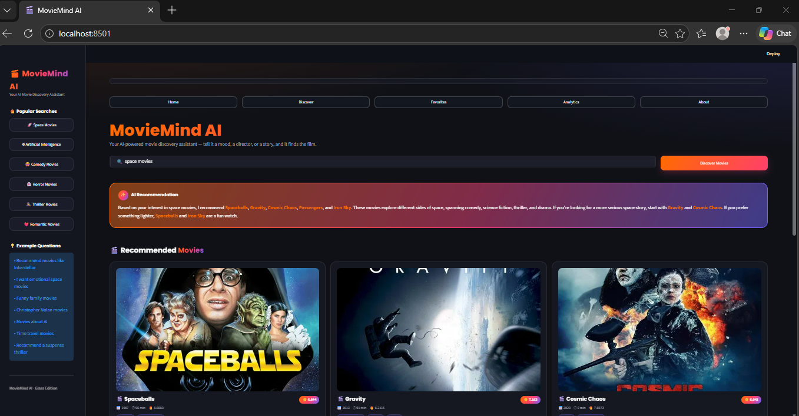
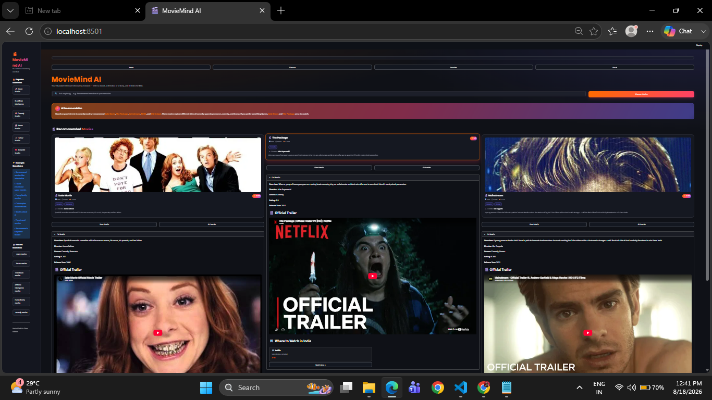
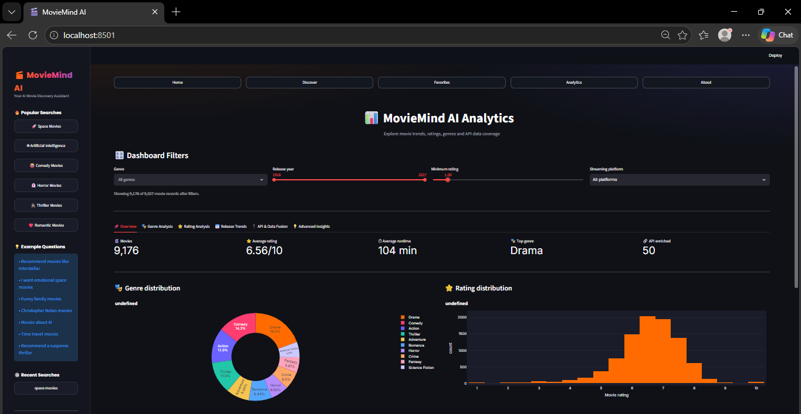
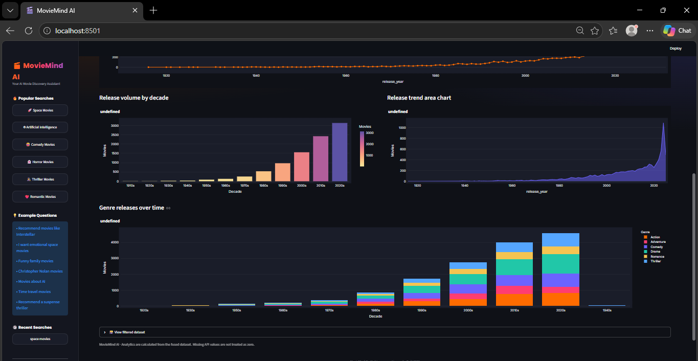
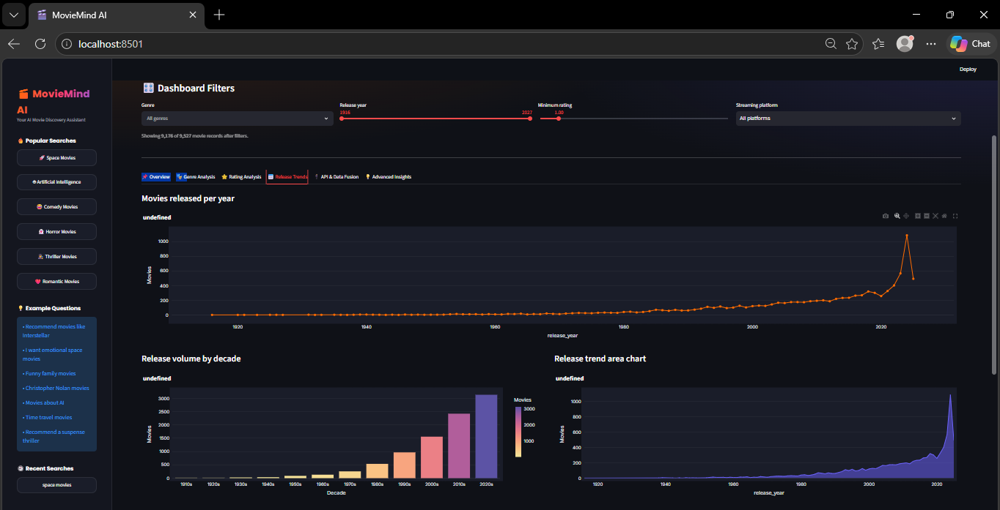
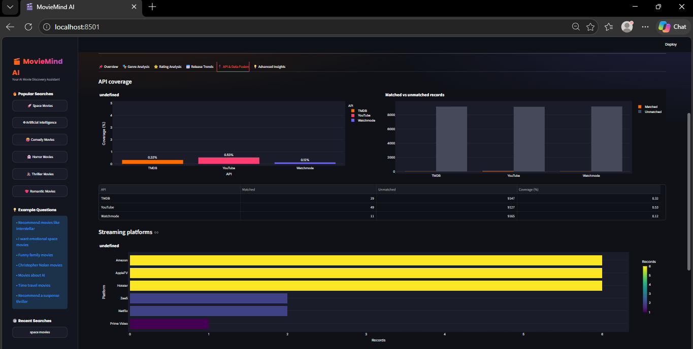

# MovieMind AI 🎬
### Movie Discovery Assistant | MCA Project Submission

**Student:** Samruddhi Sanjaykumar Patil  
**Roll Number:** MC2545  
**Course:** MCA — Data Science and Analytics  
**Academic Year:** 2026–2027  
**Project:** MovieMind AI — Movie Discovery Assistant

---

## 📌 About the Project

MovieMind AI is a movie discovery web application built with **Python and Streamlit**. It provides a user-friendly interface to explore movies, search using natural-language queries, view movie recommendations, save favorites, and analyze the movie dataset.

The application enriches movie information with external API data, including movie metadata, posters, trailers, and streaming availability.

## ✨ Main Features

- **Home:** Landing page with example queries and recommended movies.
- **Discover:** Search for movies and explore recommendations.
- **Favorites:** Save and revisit selected movies.
- **Analytics:** Explore movie data through interactive charts and filters.
- **About:** Project information.

## 📸 Application Screenshots

### 1. Home Page



### 2. Movie Recommendations



### 3. Analytics Dashboard — Overview



### 4. Analytics Dashboard — Release Trends



### 5. Analytics Dashboard — Release Trends Detail



### 6. Analytics Dashboard — API and Data Fusion



---

## 📊 Analytics Dashboard

The Analytics page contains six sections:

1. **Overview** — key dataset statistics, genre distribution, and rating distribution.
2. **Genre Analysis** — genre counts and genre-wise rating comparisons.
3. **Rating Analysis** — rating distribution and relationships between ratings, popularity, and runtime.
4. **Release Trends** — yearly and decade-wise release patterns and genre trends.
5. **API & Data Fusion** — API match coverage, matched/unmatched records, missing data, and streaming-platform information.
6. **Advanced Insights** — correlation analysis, top-rated movies, popular movies, and calculated dataset insights.

Interactive filters include genre, release year, minimum rating, and streaming platform.

## 🧰 Technology Stack

| Area | Technology |
|---|---|
| Programming language | Python |
| Web application | Streamlit |
| Data processing | Pandas, NumPy |
| Data visualization | Plotly |
| Machine learning / search libraries in the project environment | Sentence Transformers, Transformers, FAISS, scikit-learn, LangChain |
| Movie metadata | TMDB API |
| Movie trailers | YouTube Data API |
| Streaming availability | Watchmode API |
| Data files | CSV / Excel |

## 🗃️ Dataset and Data Fusion

The project uses a movie dataset and a fused dataset. Data fusion combines movie information with matching information from external sources, using movie titles as a common matching field.

Examples of information included in the project dataset:

- Movie title, overview, genres, cast, director, rating, runtime, and release date
- TMDB IDs, ratings, and poster URLs
- YouTube video IDs, trailer titles, thumbnails, and video URLs
- Streaming platforms, availability types, prices, qualities, and streaming URLs

The Analytics dashboard uses the fused dataset to calculate statistics and create visualizations. Missing API matches are treated as missing data rather than as zero-valued records.

## 🤖 Recommendation Implementation Note

The project report discusses a RAG/FAISS and language-model-based design, including Sentence Transformers and `google/flan-t5-base`. However, the `src/rag_engine.py` implementation reviewed for this project is currently template-based and deterministic. It builds recommendation explanations from retrieved movie information and predefined text patterns. Do not claim that FLAN-T5 is actively generating recommendations unless the submitted code has been updated to do so.

## 🔌 External API Integrations

The project source includes modules for:

- **TMDB API:** movie metadata and poster information.
- **YouTube Data API:** movie trailer search and video information.
- **Watchmode API:** streaming availability information.

The project report also discusses OMDb and Gemini as additional APIs or possible integrations. Include them as active integrations only if they are implemented in the submitted source code.

## 📁  Folder Structure

`MC2545_Samruddhi_Sanjaykumar_Patil`

Recommended contents:

```text
MC2545_Samruddhi_Sanjaykumar_Patil/
│
├── README.md
│
├── application/
│   ├── app.py
│   ├── requirements.txt
│   ├── data/
│   │   └── fused_movies.csv
│   └── src/
│       ├── analytics_dashboard.py
│       ├── search_engine.py
│       ├── rag_engine.py
│       ├── tmdb_api.py
│       └── ...
│
├── data/
│   ├── before_fusion.xlsx
│   └── fused_movies.xlsx
│
├── docs/
│   └── MovieMind_AI_Project_and_API_Documentation.pdf
│
└── screenshots/
    ├── home-page.png
    ├── movie-recommendations.png
    ├── analytics-overview.png
    ├── release-trends.png
    ├── release-trends-detail.png
    └── api-data-fusion.png
```

### Required files from the college instructions

1. Excel file before fusion
2. Fused Excel file
3. Application code
4. API documentation in DOC or PDF format

The project PDF is included in `docs/`. Copy your actual application source code into `application/` and add the original before-fusion and fused Excel workbooks into the top-level `data/` folder. If you only have CSV files, confirm with your faculty whether CSV is acceptable because the instructions specifically request Excel files.

## ⚙️ Installation and Setup

Run the following commands from the folder containing `app.py`.

### 1. Create a virtual environment

```bash
python -m venv venv
```

### 2. Activate it on Windows

**Command Prompt:**

```cmd
venv\Scripts\activate
```

**PowerShell:**

```powershell
.\venv\Scripts\Activate.ps1
```

### 3. Install dependencies

```bash
pip install -r requirements.txt
```

If Plotly or SciPy are not already listed in `requirements.txt`, install them:

```bash
pip install plotly scipy
```

Add any required packages to `requirements.txt` so the environment can be recreated.

### 4. Run the application

```bash
streamlit run app.py
```

Open the local address printed in the terminal, usually:

`http://localhost:8501`

## 🔐 API Credentials and Security

Configure API credentials using the exact variable names expected by the project's API modules. Never upload API keys, tokens, `.env` files, or private secrets to a public GitHub repository. Keep local secret files out of Git using `.gitignore`.

## 🛠️ Troubleshooting

**Dataset not found:** Run Streamlit from the project folder and check that `data/fused_movies.csv` exists at the path expected by the application.

**Module not found:** Activate the virtual environment and run `pip install -r requirements.txt`.

**Analytics import error:** Confirm that `analytics_dashboard.py` is located in `src/` and that the import in `app.py` matches:

```python
from src.analytics_dashboard import render_analytics_dashboard
```

**Port already in use:** Run the application on another port:

```bash
streamlit run app.py --server.port 8502
```

## 👩‍💻 Author

**Samruddhi Sanjaykumar Patil**  
**Roll Number: MC2545**  
GitHub: [Samruddhi2103](https://github.com/Samruddhi2103)

---

*MovieMind AI — Discover movies through data, search, and recommendations.*

