# Country Intelligence System

**Project Title:**  Country Intelligence System 

**Submitted By:** Krupali Prajapati

**Course:** Master of Computer Applications (MCA)

**University:** SNDT Women's University

---

# Country Intelligence System

## 1. Project Overview

The Country Intelligence System is an LLM-based application that combines World Bank World Development Indicators (WDI) data with information collected from five external APIs.

The purpose of this project is to enhance country-level analysis by integrating economic, demographic, geographical, weather, currency, air-quality, and public-holiday information.

The application uses Streamlit for its interface and Gemini with Retrieval-Augmented Generation (RAG) to answer questions using the fused country dataset.

## 2. Original Dataset

The original dataset is based on the World Bank World Development Indicators (WDI).

Six indicators are used:

- Population
- GDP
- GDP per capita
- Life expectancy
- Unemployment
- Internet usage

The project retains historical observations from the available WDI release. The six-indicator complete-case analytical coverage extends through 2017.

## 3. External APIs Used

Five external APIs are integrated into the project.

| API | Information collected |
|---|---|
| REST Countries API | Country details, capital, region, currency, languages and geographical information |
| Open-Meteo API | Temperature, humidity, precipitation and weather information |
| Frankfurter API | Currency exchange-rate information |
| OpenAQ API | Air-quality measurements such as PM2.5, PM10, NO2 and O3 |
| Nager.Date API | Public holidays and holiday dates |

## 📂 Important Project Datasets

The datasets used and generated in this project are available in the `data/` folder.

| Dataset | File Name | Description |
|---|---|---|
| Original Dataset | [`original_dataset.csv`](data/original_dataset.csv) | Original World Bank World Development Indicators (WDI) dataset |
| API Dataset | [`api_dataset.csv`](data/api_dataset.csv) | Data collected from five external APIs |
| Fused Dataset | [`fused_dataset.csv`](data/fused_dataset.csv) | Final integrated dataset combining WDI data with API data |

**Direct Dataset Links:**
- 📄 [View Original Dataset](data/original_dataset.csv)
- 📄 [View API Dataset](data/api_dataset.csv)
- 📊 [View Fused Dataset](data/fused_dataset.csv)


## Project Screenshots

### 1. Application Dashboard
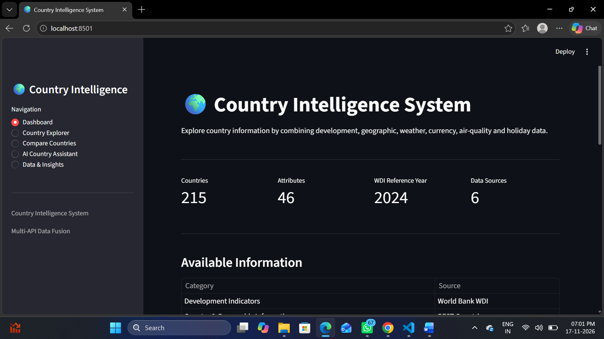

### 2. Country Explorer
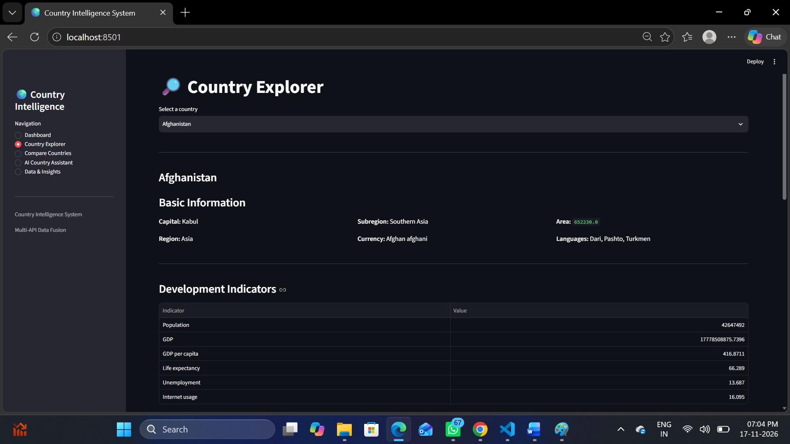
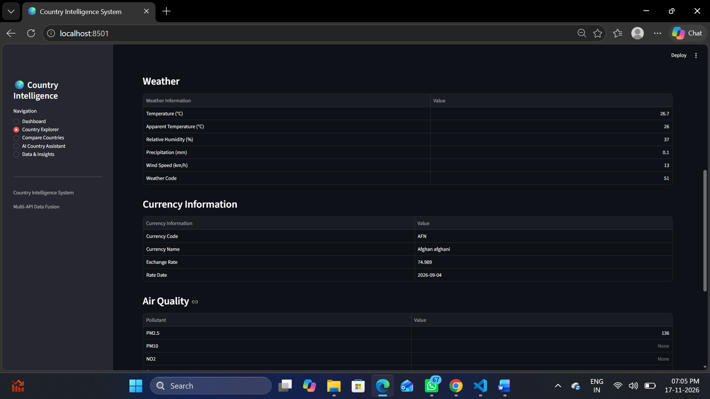
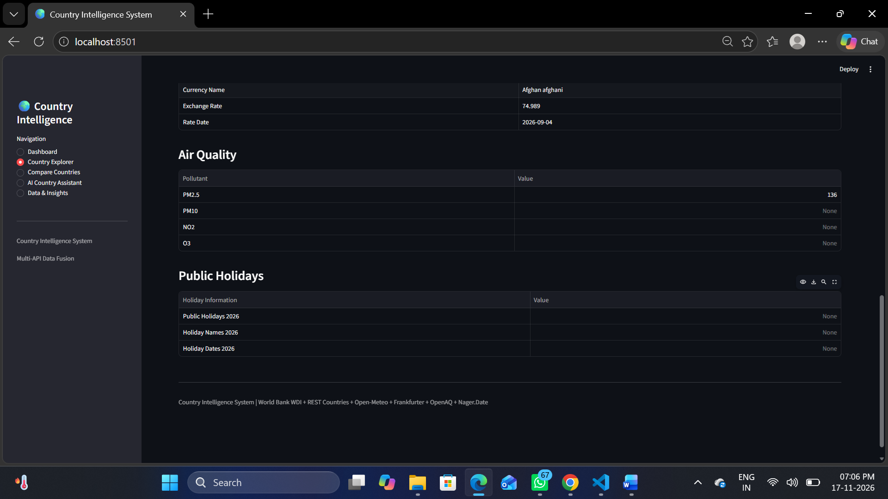

### 3. Compare Countries
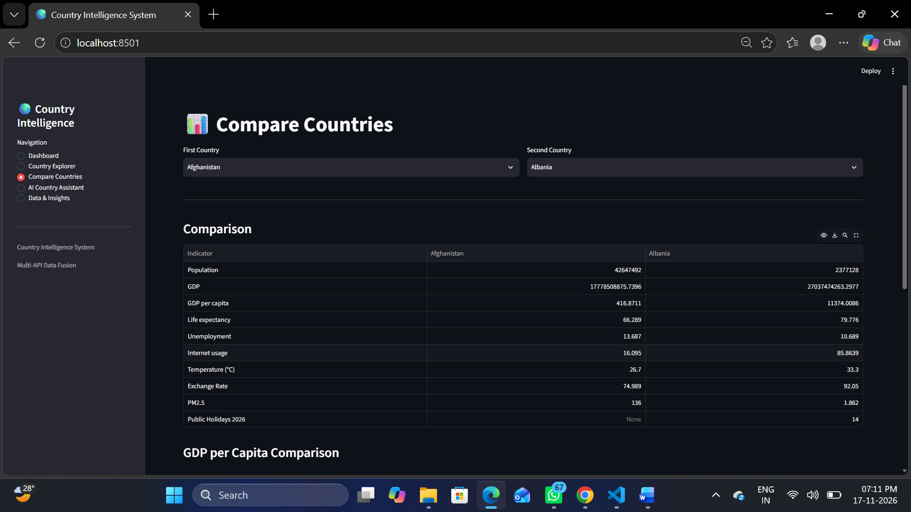
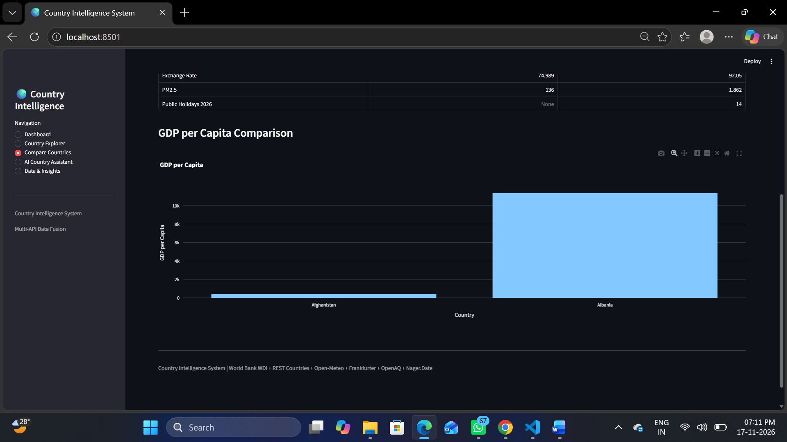

### 4. Data and Insights
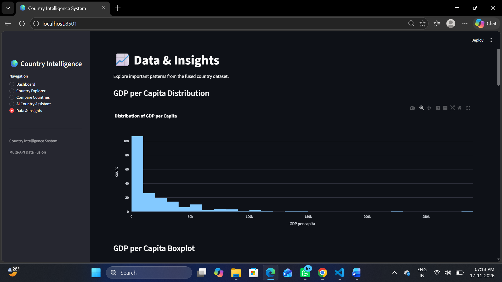
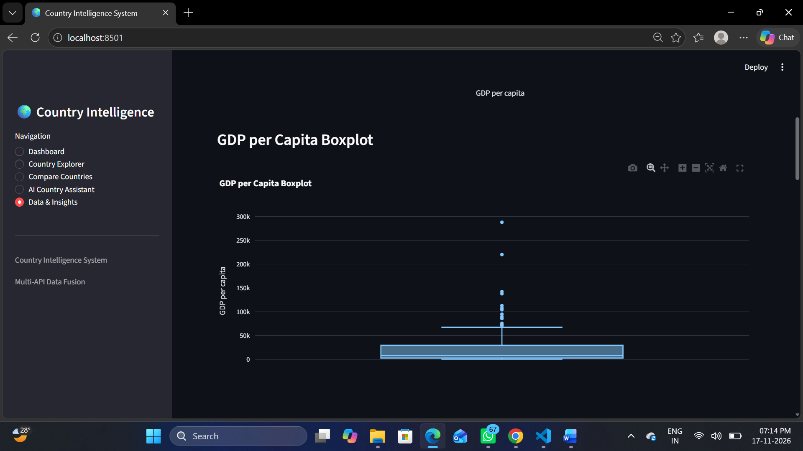
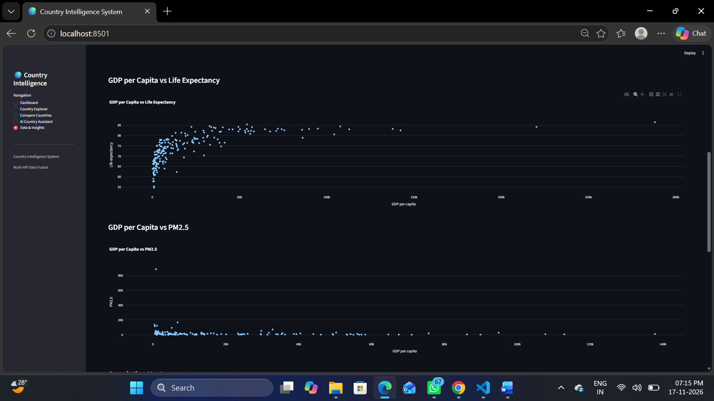
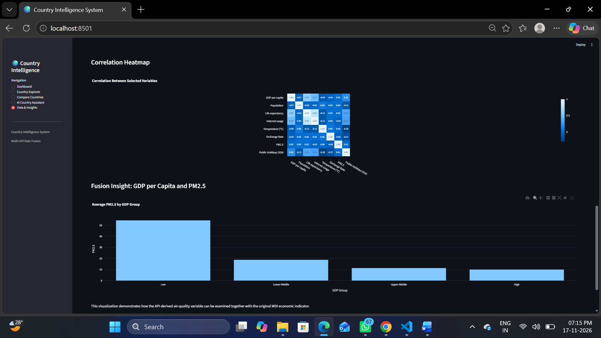

### 5. Fused Dataset


### 6. RAG Knowledge Base
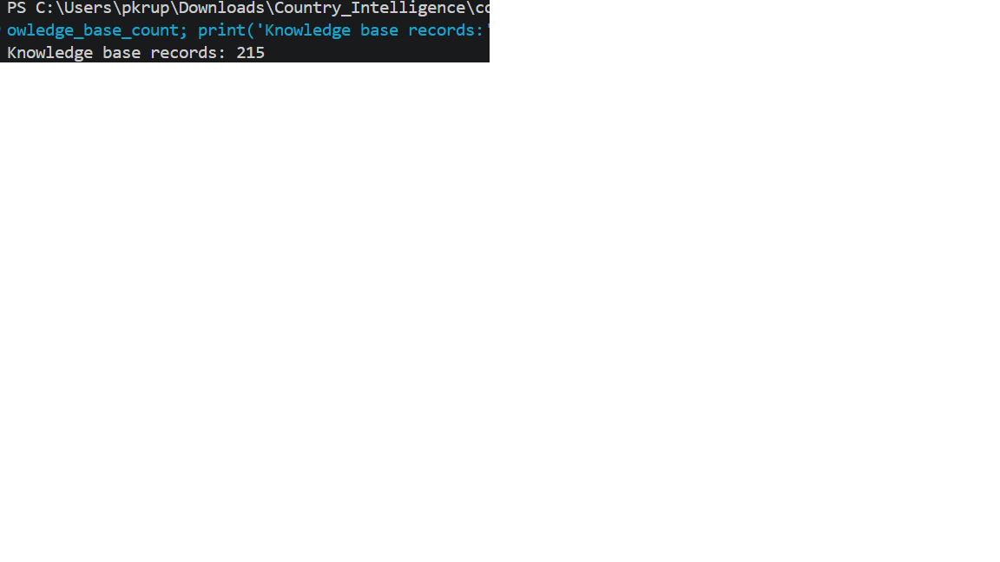

### 7. AI Country Assistant
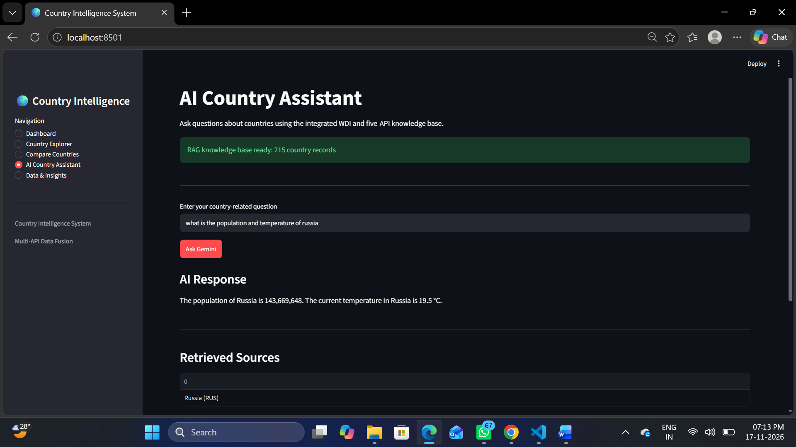


## 4. Data Fusion Process

The project follows this workflow:

1. Load the original WDI dataset.
2. Collect country information from five external APIs.
3. Validate the collected API datasets.
4. Standardize country identifiers.
5. Merge the API information with the WDI data.
6. Generate the final fused country dataset.
7. Perform data-quality assessment and exploratory data analysis.
8. Use the fused dataset in the LLM-based RAG application.

The final fused dataset contains 215 country records and 46 columns.

**Final dataset:** `data/fused_country_intelligence.csv`

## 5. Exploratory Data Analysis

Exploratory Data Analysis is performed to understand the fused dataset and identify useful patterns.

The analysis includes:

- Distribution analysis
- Boxplot analysis
- Relationship analysis using scatter plots
- Correlation heatmap
- Fusion-related visualizations
- Missing-value analysis

## 6. LLM and RAG Implementation

The application uses Google Gemini and ChromaDB to implement Retrieval-Augmented Generation.

The workflow is:

WDI and API Data → Fused Dataset → Data Preparation → Document Creation → Embedding Generation → ChromaDB Vector Database → Retriever → Gemini LLM → Answer

Each country record is converted into a document and stored in the ChromaDB knowledge base.

The embedding model used is `gemini-embedding-001`.

The Gemini generation model used is `gemini-3.1-flash-lite`.

The knowledge base contains 215 country records and is stored locally.

## 7. Project Structure

- `app.py` — Streamlit application.
- `rest_countries.py` — REST Countries API data collection.
- `open_meteo.py` — Weather data collection.
- `frankfurter.py` — Currency exchange-rate collection.
- `openaq.py` — Air-quality data collection.
- `nager.py` — Public-holiday data collection.
- `fusion.py` — Dataset integration.
- `data_quality.py` — Data-quality assessment.
- `eda_fused.py` — Exploratory data analysis.
- `build_knowledge_base.py` — Creates and updates the RAG knowledge base.
- `rag_engine.py` — Retrieves relevant records and generates LLM answers.
- `test_gemini.py` — Tests the Gemini API connection.
- `requirements.txt` — Required Python packages.
- `README.md` — Project documentation.

### Important Data Files

- `wdi_country_baseline_multiyear.csv`
- `wdi_country_analytical_multiyear.csv`
- `wdi_country_baseline_2017.csv`
- `data/fused_country_intelligence.csv`
- `data/rest_countries.csv`
- `data/open_meteo_weather.csv`
- `data/frankfurter_rates.csv`
- `data/openaq_air_quality.csv`
- `data/nager_holidays.csv`

## 8. Installation and Execution

### Requirements

- Python 3.11 or later
- Google Gemini API key
- Internet connection

### Install Dependencies

Open the project folder in the terminal and run:

```bash
pip install -r requirements.txt
```

### Configure Gemini API Key

Create a `.env` file in the project root folder and add:

```text
GEMINI_API_KEY=your_gemini_api_key
```

Replace the placeholder with your own API key. Do not share or upload the `.env` file.

### Run the Application

```bash
streamlit run app.py
```

The Streamlit application opens in the browser.

### Rebuild the Knowledge Base

To rebuild or update the local RAG knowledge base, run:

```bash
python build_knowledge_base.py
```

## 9. Application Features

The application provides the following sections:

- **Dashboard:** Overview of country intelligence data.
- **Country Explorer:** Explore information about individual countries.
- **Compare Countries:** Compare selected countries.
- **AI Country Assistant:** Ask questions using the Gemini-based RAG system.
- **Data & Insights:** Explore data analysis and visualizations.

## 10. API References

- World Bank WDI: https://databank.worldbank.org/source/world-development-indicators
- REST Countries: https://restcountries.com/
- Open-Meteo: https://open-meteo.com/en/docs
- Frankfurter: https://frankfurter.dev/
- OpenAQ: https://docs.openaq.org/
- Nager.Date: https://date.nager.at/Api

## 11. Conclusion

The project demonstrates how multiple external APIs can be integrated with an existing World Bank dataset to create a more comprehensive country intelligence system.

The fused dataset supports additional analysis and provides country-level information to the Gemini-based RAG application, enabling it to answer questions using both original WDI indicators and API-derived information.

