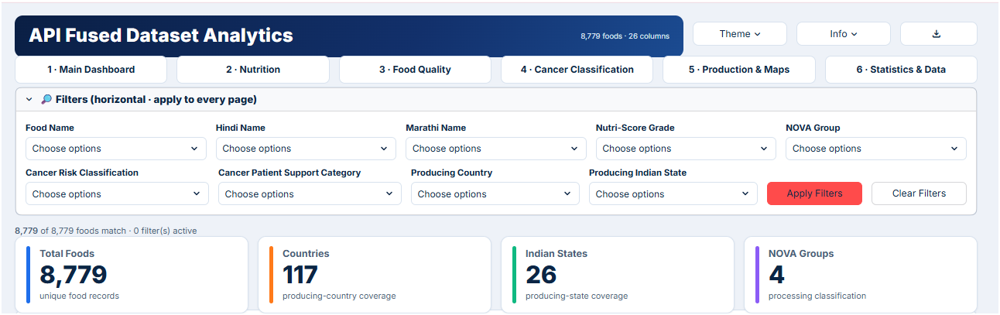
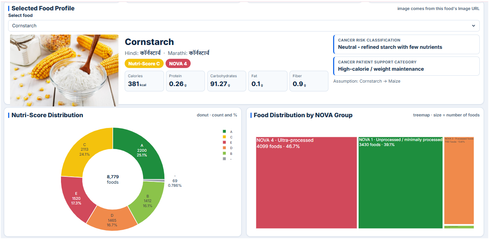
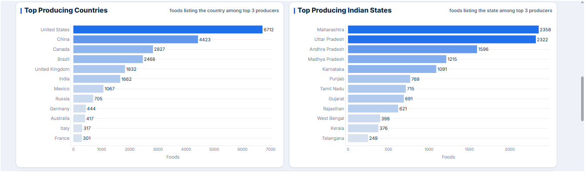
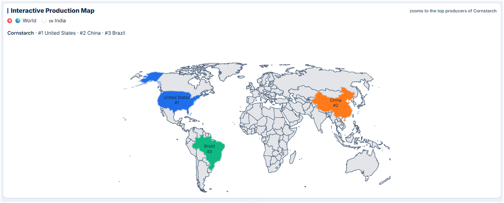
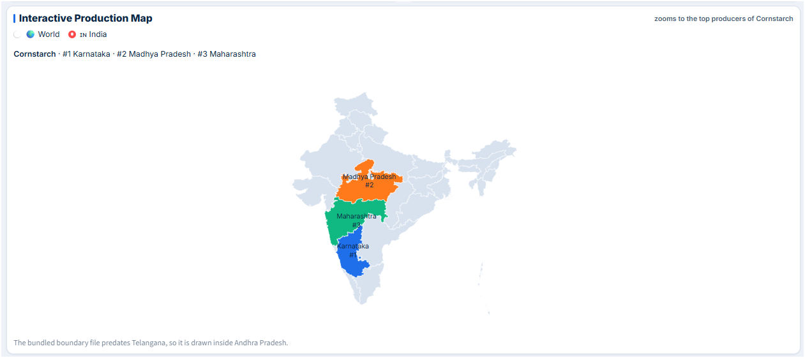
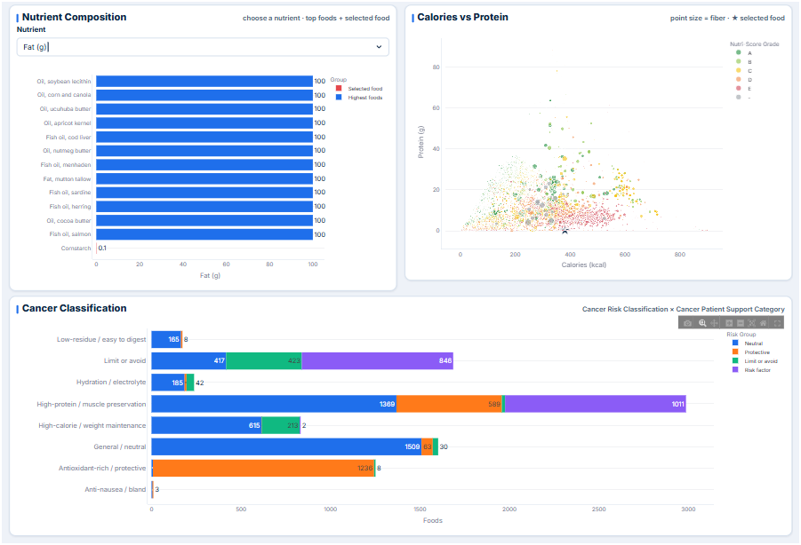
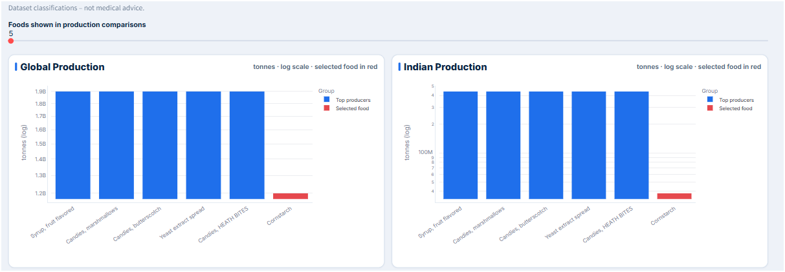

<h1 align="center">🥗 Nutricare API Fused Dataset Analytics – Food, Nutrition &amp; Production Dashboard</h1>

<p align="center">
  An interactive 6-page Streamlit dashboard that shows <b>what is in our foods</b>,
  <b>how healthy and processed they are</b>, and <b>where they are produced in the world and in India</b>.
</p>

<p align="center">
  
  
  
  
</p>

---

## Contents

- [About Project](#about-project)
- [Highlights](#highlights)
- [Pages, one by one](#pages-one-by-one)
- [Quick start](#quick-start)
- [How the data is handled](#how-the-data-is-handled)
- [Themes and filters](#themes-and-filters)
- [Project structure](#project-structure)
- [Known limitations](#known-limitations)
- [Data source](#data-source)

---

## About Project

`API_Fusion_Dataset.csv` combines several food data sources into one table of
**8,779 foods × 26 columns**: nutrition values per 100 g, Nutri-Score, NOVA processing group,
global and Indian production, Hindi and Marathi names, food photos and a cancer-related classification.

This dashboard turns that table into a clear story that anyone can follow:

1. **What** is in the food? (calories, protein, carbs, fat, fibre, minerals, vitamin C)
2. **How good and how processed is it?** (Nutri-Score A–E, NOVA groups 1–4)
3. **Where is it grown?** (top producing countries and Indian states on maps)
4. **What can I download?** (searchable data explorer, CSV / Excel export)

Everything is calculated from the file. **No data is invented.**

## Highlights

- **6 linked pages** with one shared filter bar (food name, Hindi/Marathi name, Nutri-Score, NOVA, cancer risk, support category, country, state).
- **Selected Food Profile** with photo, Hindi/Marathi names, nutrients, Nutri-Score, NOVA and classification.
- **Interactive World and India maps** that zoom to the top-3 producers of the selected food.
- **Top navigation bar, no sidebar**, so the full screen is used for charts.
- **8 colour themes** that change every chart and card.
- **Missing values are never turned into 0**; duplicates are reported, not removed.
- **Statistics page** with correlation, z-score box plot, outliers, validation report and export.
- **CSV and Excel download** of the filtered data on every page.

---

## Pages, one by one

### 1 · Main Dashboard

<!-- Main dashboard screenshots: images/222.png → images/888.png (one full page, split in 7 parts, top to bottom) -->
<p align="center">
  
  
  
  
  
  
  
</p>

<p align="center"><i>Page 1 – Main Dashboard: KPIs, food profile, Nutri-Score, NOVA, production charts, maps, nutrient charts and the dataset explorer in one screen.</i></p>

The one-page summary of the whole dataset. It answers *"what is in this dataset?"* in about ten seconds.

| Visual | What it tells you |
|---|---|
| **KPI cards** | Total foods, countries covered, Indian states covered, NOVA groups |
| **Selected Food Profile** | Photo (from `Image URL`), Hindi and Marathi names, nutrients, Nutri-Score, NOVA group and cancer classification of one chosen food |
| **Nutri-Score Distribution** | Donut chart: count and % of foods in each grade A–E |
| **Food Distribution by NOVA Group** | Treemap: bigger tile = more foods in that processing group |
| **Top Producing Countries / Indian States** | Bar charts with names on the bars, based on each food's top-3 producers |
| **Interactive Production Map** | Switch between 🌍 World and 🇮🇳 India; the map zooms to the top-3 producers of the selected food |
| **Nutrient Composition** | Choose a nutrient and see the top foods plus the selected food |
| **Calories vs Protein** | Scatter plot, point size = fibre, ★ = selected food |
| **Cancer Classification** | Stacked bar: Risk Group × Cancer Patient Support Category |
| **Global / Indian Production** | Production in tonnes (log scale), selected food in red |
| **API Fused Dataset Explorer** | All columns, search, sort, CSV / Excel download |

### 2 · Nutrition

Compares the nutrients of foods and food groups.

- **Macronutrient comparison** – Protein, Carbs, Fat, Fibre by Nutri-Score, NOVA, Risk Group or Support Category.
- **Micronutrient comparison** – Calcium, Iron, Potassium, Sodium, Vitamin C (log scale).
- **Calories vs Protein scatter** – with up to 4 comparison foods.
- **Food comparison table** and **nutrient statistics**.
- **Searchable food table** with Hindi and Marathi names.

### 3 · Food Quality

Shows how healthy and how processed the foods are.

- **Nutri-Score pie** (grades A–E, "-" = not scored).
- **NOVA group treemap** (groups 1–4).
- **Nutri-Score vs NOVA heatmap** – number of foods for each combination.
- **Counts and percentage tables** with average nutrients per Nutri-Score grade.

### 4 · Cancer Classification

Shows the dataset's own cancer-related classifications.

- **Cancer Risk Classification** – top 15 categories.
- **Cancer Patient Support Category** – donut chart.
- **Nutrition across classifications** – mean nutrients per group.
- **Category-wise food list** – filter by support category and risk group.

> These are the dataset's own classifications, **not medical advice**.

### 5 · Production &amp; Maps

Shows **where** foods are produced.

- **Interactive World map** and **India map** – show the selected food's top producers, or the number of foods per place.
- **Top producing countries / states** (choose Top N).
- **Global vs Indian production** (log scale) and **India's share** in global production.
- **Production table** sorted by global production.

### 6 · Statistics &amp; Data

The technical page for checking the data.

| Tab | What it shows |
|---|---|
| **Charts** | Nutrient correlation heatmap, z-score box plot, missing values chart |
| **Descriptive statistics** | Count, mean, std, min, max for all nutrients |
| **Dataset summary** | Column names and data types |
| **Complete dataset** | Searchable full table |
| **Duplicate records** | Fully duplicated rows and repeated food names |
| **Outliers** | Values beyond a chosen |z| threshold |
| **Validation report** | Data-quality checks and missing-value table |
| **Export** | Download CSV, Excel or statistics CSV |

---

## Quick start

```bash
# 1. get the code
git clone https://github.com/<your-username>/<your-repo>.git
cd <your-repo>/API_Fused_Dataset_Analytics

# 2. create a virtual environment
python -m venv venv
source venv/bin/activate          # Windows: venv\Scripts\activate

# 3. install the requirements
pip install -r requirements.txt

# 4. start the dashboard
streamlit run app.py
```

Streamlit opens the dashboard in your browser (normally <http://localhost:8501>).
The data file is already included in `data/`, so no extra download is needed.

## How the data is handled

- Every number is calculated from `data/API_Fusion_Dataset.csv`; **nothing is invented**.
- **Missing nutrient values stay blank**, they are never replaced with 0.
- **Duplicates are reported, not removed.**
- `Cancer_Risk_Classification` has about 1,400 different text values, so charts group it by the text before " - "
  (*Risk factor / Protective / Neutral / Limit or avoid*). The full text is shown in the food profile and tables.
- Maps colour the **top-3 producers** (Rank 1–3) of the selected food. The Production page colours every place by number of foods.
  "Unknown" and "Not produced in India" are left off the maps.
- The box plot uses **z-scores**, so nutrients with different units share one axis. The micronutrient chart uses a **log axis**.

## Themes and filters

- Choose from **8 colour themes** in the header.
- The horizontal **filter bar** (Food / Hindi / Marathi name, Nutri-Score, NOVA, cancer risk, support category, country, state) has **Apply** and **Clear** buttons.
- Filters, themes, the data-quality **Info** panel and the **CSV download** button work on every page.

## Project structure

```text
API_Fused_Dataset_Analytics/
├── app.py                          # main dashboard (page 1)
├── requirements.txt
├── .streamlit/config.toml          # hides default sidebar navigation
├── pages/
│   ├── 1_Nutrition_Analysis.py
│   ├── 2_Food_Quality_Processing.py
│   ├── 3_Cancer_Classification.py
│   ├── 4_Production_Geographic.py
│   └── 5_Statistics_Data_Explorer.py
├── modules/
│   ├── theme.py                    # 8 colour themes
│   ├── data.py                     # loading, parsing, filtering, CSV/Excel export
│   ├── stats.py                    # descriptive stats, missing values, duplicates, quality report
│   ├── images.py                   # food photo from Image URL + placeholder
│   ├── charts.py                   # main-dashboard charts and both maps
│   ├── pagecharts.py               # charts for the supporting pages
│   ├── shell.py                    # header, theme, navigation, global filters
│   └── ui.py                       # CSS and HTML snippets
├── data/
│   ├── API_Fusion_Dataset.csv      # the fused dataset
│   └── india_states.geojson        # India state boundaries
└── images/                         # screenshots used in this README
```

## Known limitations

- The bundled `india_states.geojson` is an older, simplified file **without Telangana** (it is drawn inside Andhra Pradesh).
- Food photos load in your browser from the `Image URL` column; a placeholder is shown if a link is missing or broken.
- The dataset has no per-country or per-state tonnage, so maps highlight places by **rank or food count**, not by amount.
- Cancer-related columns are dataset classifications and are **not medically verified**.

## Data source

`API_Fusion_Dataset.csv` – a fused dataset of food nutrition, Nutri-Score, NOVA processing group,
global and Indian crop production, and cancer-related food classification.
